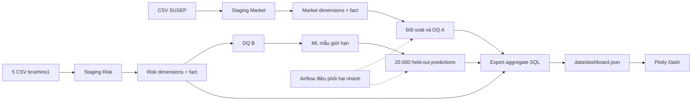

# Hiểu và vận hành Insurance Data Platform

Đây là tài liệu học, chạy dự án và chuẩn bị phỏng vấn duy nhất của repo. Bạn có thể đọc từ đầu nếu mới học Data Engineering, hoặc dùng mục lục để tìm việc cần làm. [README](README.md) giới thiệu ngắn; [CHANGELOG](CHANGELOG.md) ghi lịch sử và bằng chứng; [AGENTS](AGENTS.md) dành cho AI tiếp quản.

## Mục lục

1. [Dự án giải quyết việc gì?](#1-dự-án-giải-quyết-việc-gì)
2. [Luồng dữ liệu từ đầu đến cuối](#2-luồng-dữ-liệu-từ-đầu-đến-cuối)
3. [Đọc cây thư mục](#3-đọc-cây-thư-mục)
4. [Docker thực sự lưu gì?](#4-docker-thực-sự-lưu-gì)
5. [Cài đặt và chạy](#5-cài-đặt-và-chạy)
6. [Hợp đồng nguồn và từ điển dữ liệu](#6-hợp-đồng-nguồn-và-từ-điển-dữ-liệu)
7. [SQL, staging và kho dữ liệu](#7-sql-staging-và-kho-dữ-liệu)
8. [Data Quality, chạy lại và CDC](#8-data-quality-chạy-lại-và-cdc)
9. [Machine Learning](#9-machine-learning)
10. [Airflow](#10-airflow)
11. [Dashboard Plotly Dash](#11-dashboard-plotly-dash)
12. [Tối ưu SQL và đánh đổi](#12-tối-ưu-sql-và-đánh-đổi)
13. [Kiểm tra và xử lý lỗi](#13-kiểm-tra-và-xử-lý-lỗi)
14. [Học repo và trình bày khi tuyển dụng](#14-học-repo-và-trình-bày-khi-tuyển-dụng)
15. [Câu hỏi vấn đáp](#15-câu-hỏi-vấn-đáp)
16. [Giới hạn và hướng phát triển](#16-giới-hạn-và-hướng-phát-triển)

## 1. Dự án giải quyết việc gì?

CSV có thể mở ra xem nhưng khó đảm bảo dữ liệu đúng, chạy lại không trùng và truy vấn nhanh khi có hàng triệu dòng. Repo biến các CSV bảo hiểm thành kho dữ liệu có kiểm tra chất lượng, mô hình ML và dashboard web. Đây là dự án cá nhân để thể hiện khả năng xây một luồng dữ liệu có thể giải thích và kiểm chứng.

Có hai nhánh, gọi là **track**:

- **Track A — SUSEP Market:** 8.338.214 dòng quan sát thị trường, từ tháng 01/2003 đến 07/2023. Trả lời phí bảo hiểm/bồi thường thay đổi ra sao theo công ty, tháng, sản phẩm và bang.
- **Track B — brvehins1 Motor Risk:** 1.965.355 dòng trong năm CSV. Trả lời nhóm quan sát nào có claim, exposure bao nhiêu, mô hình liên hệ với `HasClaim` thế nào. Nguồn không cung cấp thời gian sự kiện.

Hai nguồn cùng liên quan bảo hiểm nhưng không có khóa khách hàng/hợp đồng chung. Vì vậy không nối từng dòng giữa A và B. Chúng dùng chung nền tảng SQL Server, Airflow và Dash; mỗi nhánh giữ riêng dữ liệu và ý nghĩa nghiệp vụ. Prudential từng nằm trong ý tưởng ban đầu nhưng chưa có dữ liệu vật lý; hiện không phải chức năng đã triển khai.

**Cách nói ngắn khi phỏng vấn:** “Em xây Insurance Data Platform với hai nguồn độc lập. Dữ liệu đi qua staging, star schema và quality gate; một nhánh phục vụ phân tích thị trường, nhánh kia phục vụ mô hình HasClaim trên mẫu có giới hạn tài nguyên. Em đo hiệu quả index và trình bày kết quả bằng Plotly Dash.”

## 2. Luồng dữ liệu từ đầu đến cuối



Hình dung một nhà kho: CSV là hàng giao đến, staging là khu nhận hàng có phiếu giao nhận, DWH là kệ đã sắp xếp theo cách tra cứu, DQ là trạm kiểm hàng. Dashboard chỉ nhận bảng tổng hợp đã chuẩn bị. Airflow là lịch và người điều phối công việc, không phải nơi chứa hàng.

1. **Profile:** đọc nguồn để biết schema, số dòng, null, duplicate và độ chính xác số. Đây là bước tìm hiểu dữ liệu, không tự sửa CSV.
2. **Ingest:** Python đọc CSV theo batch và ghi vào `stg.*`. Mỗi dòng có dấu vết nguồn để truy lại.
3. **Transform:** stored procedure tạo/cập nhật dimension rồi nạp fact.
4. **Reconcile và DQ:** kiểm số dòng, tổng tiền, khóa, null, lineage và đặc điểm nguồn. Lỗi cứng phải dừng consumer phía sau.
5. **ML B:** trích mẫu xác định từ DWH, chia nhóm train/validation/test, fit preprocessing và mô hình. Scoring ghi kết quả vào bảng prediction riêng.
6. **Export:** truy vấn aggregate thật từ SQL Server và ghi JSON kèm thời điểm xuất. Không xuất danh tính từng dòng lên dashboard.
7. **Dash:** đọc JSON để lọc/vẽ biểu đồ. Mở trang không quét lại 10 triệu dòng trong database.

Airflow hiện kết thúc ở trạng thái consumer ready. Sau một run thành công, gọi `manage.py export` để công bố snapshot mới; DAG chưa tự ghi snapshot dashboard.

## 3. Đọc cây thư mục

Chỉ cần nhớ **sáu thư mục chính**. Các thư mục ẩn `.git`, `.venv` là công cụ, không phải nghiệp vụ.

```text
1-personal-project/
├── README.md               Giới thiệu, hình dashboard, cách chạy nhanh
├── GUIDE.md                Toàn bộ hướng dẫn học và vận hành này
├── CHANGELOG.md            Nhật ký quan trọng và bằng chứng kiểm tra
├── AGENTS.md               Trạng thái bàn giao cho AI
├── docker-compose.yml      Khai báo ba dịch vụ và nơi lưu dữ liệu
├── requirements*.txt       Dependency local và công cụ kiểm thử
├── .env.example            Mẫu cấu hình, không chứa mật khẩu thật
├── dashboard/
│   ├── app.py              Trang, KPI, biểu đồ, callback và tải CSV
│   ├── data.py             Đọc snapshot, áp dụng bộ lọc
│   └── assets/             CSS, banner README và ảnh dashboard thật
├── pipeline/               Python vận hành dữ liệu và DAG Airflow
├── database/
│   ├── migrations/         V1–V14: lịch sử tạo/nâng cấp database
│   └── performance.sql     Hai workload đo hiệu năng có thể chạy lại
├── infra/                  Dockerfile và dependency riêng cho container
├── data/
│   ├── raw/                CSV gốc, chỉ đọc, không push
│   ├── models/             Mô hình joblib + metadata local, không push
│   ├── generated/          Kết quả chạy lại, có thể tái tạo, không push
│   ├── dashboard.json      Snapshot aggregate có thời điểm xuất, có push
│   └── evidence.json       Bằng chứng lịch sử gộp dạng máy đọc, có push
└── tests/                  Kiểm tra tính nhất quán và thao tác trình duyệt
```

### Các file trong pipeline cần hiểu

- `config.py`: đọc `.env`, tạo connection SQL Server. Mật khẩu lấy từ môi trường, không ghi trong code.
- `manage.py`: cửa vào vận hành: migrate, load-market, load-risk, quality, status, score, export.
- `load_susep_to_staging.py`, `load_brvehins1_to_staging.py`: đọc CSV theo contract, chuyển kiểu và nạp từng batch.
- `profile_susep.py`, `profile_brvehins1.py`: thống kê nguồn bằng luồng đọc và vùng làm việc tạm; không load toàn bộ vào RAM.
- `profile_brvehins1_numeric_precision.py`: kiểm riêng chữ số phần nguyên/phần thập phân để chọn kiểu SQL đúng.
- `reconcile_susep_source_to_fact.py`: đọc lại raw, đối chiếu staging/fact và tổng measure. Khác với chỉ nhìn COUNT trong database.
- `modeling.py`: feature, mẫu xác định, cách chia tập, preprocessing và đánh giá chung.
- `train_risk_model.py`: thử baseline/alternative, chọn trên validation, final fit, lưu artifact. Không cần gọi mỗi lần mở dashboard.
- `predict_risk_batch.py`: load artifact và chấm held-out, ghi prediction qua một batch SQL.
- `run_synthetic_cdc_demo.py`: demo thay đổi có kiểm soát, tách khỏi bảng nguồn thật.
- `airflow_dag.py`: mô tả thứ tự hai nhánh Airflow và cách lỗi DQ chặn consumer.
- `validate_repo.py`: kiểm tĩnh layout, syntax, link và định dạng snapshot. Không thay thế chạy SQL hay trình duyệt.

`docs/`, `reports/`, `log/`, `powerbi/`, `notebooks/`, `scripts/`, `ml/`, `dags/`, `airflow/`, `sql/` cũ đã được gom hoặc thay thế. Không cần tìm một tài liệu hướng dẫn thứ hai trong các thư mục đó.

## 4. Docker thực sự lưu gì?

**Image** giống bộ cài đóng gói: SQL Server image chứa chương trình database; Airflow image chứa Airflow + ODBC + thư viện ML; dashboard image chứa Python + Dash + code giao diện. Image không chứa CSV, mật khẩu hay mô hình local vì `.dockerignore` loại dữ liệu và secret khỏi build context.

**Container** là một bản chương trình đang chạy từ image. Xóa container có thể xóa những file chỉ nằm trong lớp ghi tạm của nó. Vì vậy dữ liệu quan trọng phải được mount ra ngoài.

**Named volume** do Docker quản lý:

- `sqlserver_data` mount vào `/var/opt/mssql`: database `.mdf/.ldf`, transaction log và dữ liệu SQL. Nó chứa cả staging, dimensions, facts, bảng prediction, metadata ingestion, DQ log, CDC demo. Database không nằm trong `database/` của repo; thư mục đó chỉ chứa SQL tạo database.
- `airflow_state` mount vào `/opt/airflow/state`: SQLite metadata Airflow, trạng thái DAG/task và user. Mật khẩu admin tạo bởi `airflow standalone` có thể còn nằm trong container/log; đặt lại tài khoản nếu tạo lại container.
- `airflow_logs` mount vào `/opt/airflow/logs`: log tác vụ scheduler/worker. Đây là log kỹ thuật runtime, khác nhật ký dự án `CHANGELOG.md`.

Compose thường thêm tên project vào trước volume, ví dụ `1-personal-project_sqlserver_data`. Giữ nguyên project name khi dùng lại dữ liệu cũ. Chạy Compose ở thư mục khác hoặc dùng `-p` khác có thể tạo volume mới và làm bạn tưởng database mất.

**Bind mount** trỏ tới file/thư mục có thật trên máy:

- `data/raw` được mount `:ro` để container chỉ đọc nguồn.
- Airflow đọc `pipeline/`, `data/models/` bằng mount chỉ đọc; ghi output vào `data/generated/`.
- Dash đọc `data/` qua mount chỉ đọc. Container dashboard không được cấp mật khẩu SQL; chỉ dùng snapshot aggregate.

Lệnh thường dùng:

```powershell
docker compose ps
docker volume ls
docker compose logs --tail 50 sqlserver
docker compose --profile orchestration logs --tail 50 airflow
docker compose stop
docker compose down
```

`stop` chỉ dừng. `down` xóa container/network, mặc định giữ named volume. **Không dùng `docker compose down -v` với dữ liệu cần giữ:** `-v` xóa volume SQL/Airflow. Git không backup database. Muốn backup thực sự phải dùng SQL Server `BACKUP DATABASE` và sao chép `.bak` ra nơi an toàn; zip tài liệu không phải backup database.

Port local: SQL Server `1433`, Airflow `8080`, Dash `8050`. Compose bind vào `127.0.0.1`, phù hợp demo trên máy cá nhân. Airflow standalone/SQLite là cấu hình học và demo tuần tự, chưa phải cụm production.

## 5. Cài đặt và chạy

### 5.1 Chỉ xem dashboard từ snapshot đi kèm

Cần Python **3.12**. Mở PowerShell tại thư mục repo:

```powershell
py -3.12 -m venv .venv
.venv\Scripts\python.exe -m pip install -r requirements.txt
.venv\Scripts\python.exe -m dashboard.app
```

Mở **http://127.0.0.1:8050**. Cách này không cần SQL Server, raw CSV hay model binary. `data/dashboard.json` là kết quả aggregate xuất từ database thật, không phải số liệu dựng. Thời điểm xuất hiển thị trên giao diện. Thay dữ liệu SQL không tự đổi trang cho đến khi export lại.

Nếu `.venv` đã tồn tại thì dùng lại, không cần tạo lần nữa. Dùng `.venv\Scripts\python.exe` giúp tránh vô tình dùng Python/thư viện khác của hệ thống.

### 5.2 Bật kho dữ liệu đầy đủ

Cần Docker Desktop đang chạy và **ODBC Driver 18 for SQL Server** trên host. Python `pyodbc` là cầu nối; nó không tự cài native ODBC driver.

```powershell
Copy-Item .env.example .env
```

Sửa `.env`: đặt `SQLSERVER_SA_PASSWORD` đủ độ phức tạp và `AIRFLOW_SECRET_KEY` dài, ngẫu nhiên nếu dùng Airflow. Không ghi secret vào README hoặc Git. Nếu database volume đã có, dùng đúng mật khẩu đã đặt ban đầu; đổi biến môi trường không tự đổi mật khẩu `sa` trong database hiện hữu.

```powershell
docker compose up -d sqlserver
docker compose logs --tail 30 sqlserver
.venv\Scripts\python.exe pipeline/manage.py migrate
```

Đợi SQL Server báo sẵn sàng trước migration. `migrate` chạy V1→V14 theo số, bỏ qua version đã ghi trong `meta.SchemaVersion`. Không sort tên kiểu chữ vì sẽ ra V1, V10, V11 trước V2. Migration hiện mặc định database `DWH_Insurance`; thay tên database cần sửa migration có kế hoạch, không chỉ đổi biến `.env`.

Đặt nguồn đã có quyền sử dụng vào đúng đường dẫn, không chỉnh nội dung:

```text
data/raw/susep.gov.br/insurance_dataset.csv
data/raw/brvehins1/brvehins1a.csv
data/raw/brvehins1/brvehins1b.csv
data/raw/brvehins1/brvehins1c.csv
data/raw/brvehins1/brvehins1d.csv
data/raw/brvehins1/brvehins1e.csv
```

```powershell
.venv\Scripts\python.exe pipeline/validate_repo.py --raw
.venv\Scripts\python.exe pipeline/manage.py load-market
.venv\Scripts\python.exe pipeline/manage.py load-risk
.venv\Scripts\python.exe pipeline/manage.py quality
.venv\Scripts\python.exe pipeline/manage.py status
.venv\Scripts\python.exe pipeline/reconcile_susep_source_to_fact.py
```

Nạp lần đầu có thể lâu vì hơn 10 triệu dòng và index. Loader không phải lệnh xóa/nạp lại toàn bộ. Cùng source đã SUCCESS sẽ SKIPPED. Nếu nguồn thay phiên bản, phải kiểm contract và chính sách thay thế trước; không coi đây là xử lý schema drift tự động.

### 5.3 ML và làm mới dashboard

Máy hiện tại đã có artifact trong `data/models/`; có thể chấm lại mà không train:

```powershell
.venv\Scripts\python.exe pipeline/manage.py score
.venv\Scripts\python.exe pipeline/manage.py export
```

Clone mới không mang theo model binary. Khi cần tự tái tạo model và đã load Track B, mới chạy:

```powershell
.venv\Scripts\python.exe pipeline/train_risk_model.py
.venv\Scripts\python.exe pipeline/manage.py score
.venv\Scripts\python.exe pipeline/manage.py export
```

Training ghi artifact theo version cố định hiện tại, nên muốn thí nghiệm model mới phải lưu version mới trước để không ghi đè artifact đang dùng. Export đọc database trong một transaction nhất quán; có thể giữ read lock trong vài giây, nên chạy sau pipeline thay vì giữa lúc đang ghi khối lượng lớn. Export thất bại sẽ giữ bản snapshot cũ nhờ ghi file tạm rồi thay thế nguyên tử.

### 5.4 Chạy dashboard bằng Docker

```powershell
docker compose --profile analytics up -d --build dashboard
```

Container dùng Gunicorn để phục vụ Dash. Không chạy đồng thời app Python và container trên port 8050. Python local là cách nhanh nhất để xem snapshot, còn Compose đọc cấu hình secret SQL chung từ `.env` ngay cả khi chỉ khởi động dashboard.

### 5.5 Bật Airflow khi cần điều phối

```powershell
docker compose --profile orchestration up -d --build airflow
docker compose --profile orchestration logs --tail 80 airflow
```

Mở http://127.0.0.1:8080, lấy tài khoản local từ log standalone và đổi mật khẩu khi cần. Bật DAG `insurance_data_platform`, trigger sau khi database/nguồn/model đã sẵn sàng. DAG có `schedule=None`, không tự chạy theo giờ. Khi đổi dependency cần build lại image; đổi Python trong bind mount thì scheduler sẽ đọc lại.

## 6. Hợp đồng nguồn và từ điển dữ liệu

**Data contract** là thỏa thuận có thể kiểm: file nào hợp lệ, mỗi dòng nghĩa là gì, kiểu dữ liệu, trường bắt buộc, lỗi nào phải dừng. Chọn SQL schema sau khi nhìn nguồn thật giúp tránh thiết kế bảng khách hàng/hợp đồng không có dữ liệu.

### 6.1 Track A: tám cột SUSEP

Header chính xác:

```text
company_code,company_name,year_month,product,state,premiums,claims,claim_premium_ratio
```

- `company_code`: mã công ty, SQL `INT`; tên công ty không được hiểu là tên khách hàng.
- `company_name`: tên công ty; staging có giới hạn độ dài theo nguồn đã profile.
- `year_month`: ngày ISO đầu tháng, SQL `DATE`; dimension có năm và tháng để lọc.
- `product`: nhãn sản phẩm nguồn, giữ nguyên ý nghĩa.
- `state`: mã bang; staging giữ lexical gốc, dimension chuẩn hóa `UPPER`.
- `premiums`, `claims`: tổng phí/tổng bồi thường theo grain nguồn; giữ cả chuỗi `*Raw` và số phân tích `DECIMAL(38,18)`.
- `claim_premium_ratio`: tỷ lệ do nguồn đưa; `NA` thành `NULL`, có giá trị âm/cực trị. Không cộng hoặc lấy trung bình đơn giản để ra loss ratio toàn thị trường.

**Grain** = một công ty × một tháng × một sản phẩm × một bang. Khóa tự nhiên là `company_code + year_month + product + state`; profiling không thấy trùng grain trên snapshot 8.338.214 dòng. Dấu vết kỹ thuật là `SourceFile + SourceFileSha256 + SourceRowNumber`, kèm `BatchId`, `SourceRecordHash`, thời điểm load.

Nguồn có 40 biến thể state phân biệt hoa/thường, gồm 27 mã bang chuẩn và 103 dòng biến thể chữ thường; DWH gom đúng về 27 mã. Không dựng thêm region hay map sang danh tính của Track B.

**Vì sao giữ chuỗi số gốc?** SQL Server chỉ cho precision tối đa 38. Một số dòng cần nhiều chữ số phần nguyên, dòng khác cần tới 29 chữ số phần lẻ; một `DECIMAL(p,s)` cố định không giữ được mọi biểu diễn. Loader giữ text gốc để audit, đồng thời làm tròn half-even về 18 chữ số phần lẻ cho phân tích. Sai số mỗi giá trị được làm tròn không quá `0,5 × 10^-18`. Dashboard đổi aggregate sang float để vẽ; không dùng biểu đồ làm sổ cái tài chính chính xác tuyệt đối.

Phí âm 116.980 dòng, claims âm 301.382 dòng là warning cần giải thích nghiệp vụ, vẫn được giữ. Ratio nguồn có 5.167.094 `NA` và 238.088 giá trị âm. Không tự sửa dấu hay điền ratio để đồ thị trông đẹp. Đơn vị tiền nguồn chưa được xác nhận đầy đủ nên dashboard ghi “đơn vị nguồn”, không tự gắn BRL.

### 6.2 Track B: 23 cột brvehins1

```text
Gender,DrivAge,VehYear,VehModel,VehGroup,Area,State,StateAb,
ExposTotal,ExposFireRob,PremTotal,PremFireRob,SumInsAvg,
ClaimNbRob,ClaimNbPartColl,ClaimNbTotColl,ClaimNbFire,ClaimNbOther,
ClaimAmountRob,ClaimAmountPartColl,ClaimAmountTotColl,ClaimAmountFire,ClaimAmountOther
```

- **Hồ sơ lái xe:** `Gender`, `DrivAge` là nhãn/nhóm nguồn, không tự diễn giải thành tuổi chính xác hoặc danh tính.
- **Xe:** `VehYear` là năm xe (`SMALLINT`, nullable); `VehModel`, `VehGroup` là descriptor. Không có VIN.
- **Địa lý:** `Area`, `State`, `StateAb`; cặp State/StateAb phải cùng null hoặc mapping nhất quán.
- **Exposure:** `ExposTotal` dùng `DECIMAL(21,17)` để giữ precision đã quan sát; `ExposFireRob` dùng `DECIMAL(19,6)`.
- **Phí:** `PremTotal` dùng `DECIMAL(34,27)`; `PremFireRob` dùng `DECIMAL(19,6)`.
- **Số tiền bảo hiểm:** `SumInsAvg`, `DECIMAL(19,6)`; không tự giả định cùng nghĩa với premium.
- **Số claim:** năm cột `ClaimNb*`, `INT`, không âm.
- **Tiền claim:** năm cột `ClaimAmount*`, `DECIMAL(19,6)`, không âm.

Mỗi partition có 393.071 dòng; tổng 1.965.355. Một dòng là **quan sát rủi ro tổng hợp do nguồn cung cấp**, không phải một người, một hợp đồng hoặc một claim event riêng. Khóa kỹ thuật `SourceFile + SourceRowNumber` giữ thứ tự dòng; `SourceRecordHash` là fingerprint nội dung.

Có 14 dòng logical trùng trong nguồn. Giữ tất cả vì mỗi dòng có lineage riêng; không tự deduplicate dựa vào fingerprint. Descriptor có thể `NULL`; các measure bắt buộc không null, parse hữu hạn và không âm. `VehYear=0` được giữ để review. Exposure/phí bằng 0 hợp lệ; tỷ lệ tương ứng trả `NULL`. Hai cột FireRob bằng 0 trong snapshot là đặc điểm đã quan sát, không thành quy tắc mọi dữ liệu tương lai phải bằng 0.

### 6.3 Chỉ số dẫn xuất

- `TotalClaimCount` = tổng năm cột số claim.
- `TotalClaimAmount` = tổng năm cột tiền claim.
- `HasClaim` = 1 nếu TotalClaimCount > 0, ngược lại 0.
- `ClaimFrequency` = TotalClaimCount / ExposTotal khi exposure > 0; là số claim trên exposure, có thể khác tỷ lệ quan sát có claim.
- `LossRatio` = TotalClaimAmount / PremTotal khi premium > 0 ở Track B.
- Dashboard Track A dùng `SUM(Claims) / SUM(Premiums)` khi tổng premium > 0. Đây là ratio dẫn xuất; không phải SUM/AVG của ratio nguồn.
- Tỷ lệ nhóm có claim = số quan sát `HasClaim=1` / số quan sát, không chia exposure.

## 7. SQL, staging và kho dữ liệu

**Schema** SQL là nhóm tên trong cùng database: `stg` nhận dữ liệu, `dwh` phục vụ phân tích, `meta` ghi quản trị/lineage, `dq` ghi kiểm tra chất lượng. Chúng khác thư mục trên ổ đĩa.

**Star schema** đặt fact ở giữa và dimension xung quanh:

- Track A: `FactSusepInsuranceMarket` liên kết `DimSusepMonth`, `DimSusepCompany`, `DimSusepProduct`, `DimSusepState`.
- Track B: `FactRiskObservation` liên kết `DimDriverProfile`, `DimVehicle`, `DimGeography`. Prediction nằm ở `dwh.RiskObservationPrediction`, có lineage riêng theo model/population.

**Fact** lưu measure ở grain xác định. **Dimension** lưu descriptor dùng lọc/nhóm. **Surrogate key** là khóa số nội bộ DWH giúp fact liên kết dimension ổn định; nó không chứng minh nguồn có CustomerId. Unknown member của dimension là nhãn kỹ thuật cho descriptor thiếu, không phải khách hàng giả.

### Migration V1–V14 làm gì?

1. V1 tạo database, schema, manifest và audit ingestion.
2. V2 tạo typed staging Track B và vùng landing lịch sử.
3. V3 ghi nhận cơ chế loader Python phù hợp CSV.
4. V4 bỏ bulk landing không được hỗ trợ trong môi trường này.
5. V5 bảo toàn precision ExposTotal/PremTotal theo profiling thực tế.
6. V6 tạo dimension và procedure load descriptor Track B.
7. V7 tạo FactRiskObservation và procedure load fact.
8. V8 tạo executable quality gate Track B.
9. V9 tạo CDC demo cô lập trong `meta`.
10. V10 tạo bảng prediction.
11. V11 tạo staging/audit SUSEP.
12. V12 tạo dimensions/fact/procedure Track A.
13. V13 tạo quality gate Track A.
14. V14 tạo hai covering index theo workload thật.

Không gộp migration đã áp dụng thành một “file SQL cuối” vì sẽ mất lịch sử version và khó cập nhật database cũ. Không sửa logic migration đã có để che lỗi; thay đổi schema mới nên thêm migration version tiếp theo và cập nhật validator.

`GO` là dấu chia batch của công cụ client, không phải câu SQL gửi nguyên vào pyodbc. `manage.py` tách từng batch rồi execute. V1 dùng autocommit vì `CREATE DATABASE` không được bọc trong transaction người dùng thông thường. Các procedure load fact/dimension được gọi trong transaction riêng.

## 8. Data Quality, chạy lại và CDC

### Hard failure và warning

Hard failure là vi phạm làm dữ liệu không đáng tin: sai header, không parse được measure, duplicate technical key, thiếu FK, lệch reconciliation. Warning là đặc điểm cần điều tra nhưng không đủ lý do xóa nguồn: phí âm SUSEP, 14 duplicate logical B, năm xe 0. Cùng một rule về dấu có thể khác giữa hai nguồn vì contract khác nhau.

Track A ghi `dq.SusepQualityCheckLog`; Track B ghi `dq.QualityCheckLog`. `meta.IngestionBatch`, `meta.PipelineAudit` và các bảng audit SUSEP lưu thông tin batch. Đây là log nghiệp vụ trong database, không được gộp/xóa thành file markdown. `CHANGELOG.md` chỉ gom nhật ký phát triển và kết quả kiểm tra quan trọng.

### Idempotency: chạy hai lần có bị nhân đôi?

Track A kiểm fingerprint file và batch SUCCESS, lấy application lock để tránh hai loader cùng nạp một nguồn, dùng unique technical identity. Cùng file đã nạp trả SKIPPED. Track B kiểm partition canonical và batch thành công; unique key bảo vệ `SourceFile + SourceRowNumber`. Retry batch dở dang có xử lý riêng, không xóa batch đã thành công tùy tiện.

Fact load và prediction có khóa chống nhân đôi. Prediction dùng `(SourceFile, SourceRowNumber, ScoringPopulation, ModelVersion)`; MERGE cập nhật dòng cũ và run ID mới. Vì vậy bảng prediction thể hiện lần scoring hiện tại cho semantics đó, không phải kho lịch sử mọi lần dự đoán. Muốn audit đầy đủ nhiều run cần bảng lịch sử bổ sung.

**Reconciliation** không chỉ là “không lỗi”: kiểm source count = staging count = fact count, tổng measure, reject, uniqueness, null và lineage. Khớp COUNT chưa chứng minh tổng tiền hoặc nội dung khớp.

### Vì sao phải đọc hết result set?

Một procedure SQL có thể SELECT kết quả trước rồi mới `THROW`. Nếu Python chỉ đọc result set đầu, task có thể báo thành công dù SQL đã phát hiện lỗi. Sau execute quality gate, code dùng `while cursor.nextset(): pass` để nhận lỗi ở mọi result set. Đây từng là lỗi thật đã sửa; cần giữ hành vi này khi refactor.

### Incremental khác CDC

Ingest incremental ở đây là nhận batch/partition chưa xử lý và bỏ qua phần đã SUCCESS. CSV lịch sử không tự có sự kiện update/delete. **CDC** đọc thay đổi từ transaction log SQL Server. Repo chỉ demo CDC trên `meta.CdcDemoOperationalRecord` với dòng được đánh dấu; không giả là lịch sử thay đổi của raw.

Demo tạo insert, update-before/update-after rồi insert; capture được 4 changes. Consumer có ledger identity `(ConsumerName, StartLsn, SequenceValue, OperationCode)` và watermark LSN. Replay cùng changes ghi thêm 0. Watermark là dấu trang, ledger là chống đọc trùng; nhiều event có thể cùng LSN nên chỉ lưu “LSN lớn nhất” chưa đủ mọi trường hợp.

Muốn học demo sau migration V9 và SQL Agent đang chạy:

```powershell
.venv\Scripts\python.exe pipeline/run_synthetic_cdc_demo.py
```

Lệnh này tạo dữ liệu demo có chủ đích trong schema `meta`; không phải bước bắt buộc khi mở dashboard.

## 9. Machine Learning

### Bài toán và ranh giới

Target là `HasClaim` cùng snapshot, không phải xác suất một khách hàng sẽ claim năm sau. Nguồn không có observation date hoặc thời điểm cấp đơn, nên chưa thể chứng minh dự báo tương lai. Gọi đúng là **mô hình liên hệ HasClaim trên quan sát tổng hợp cùng thời điểm**.

Feature hiện dùng: `Gender`, `DrivAge`, `VehYear`, `VehModel`, `VehGroup`, `Area`, `StateAb`. Không dùng `ClaimNb*`, `ClaimAmount*`, `TotalClaimCount`, `TotalClaimAmount`, `HasClaim`, `ClaimFrequency`, `LossRatio` làm feature vì chúng chứa trực tiếp/gián tiếp kết quả cần dự đoán. Premium/exposure/sum insured chưa có time semantics rõ nên không dùng trong model hiện tại.

### Mẫu và chia tập

Một lần thử trước đã vật hóa gần 1,97 triệu dòng với category lớn, rồi một thử 300k gặp giới hạn tài nguyên. Cách hiện tại lấy nhóm hash có thứ tự xác định, đủ nhóm positive/negative để có **100.004 dòng**. Đây là mẫu giới hạn có thể tái lập, không phải khẳng định đại diện hoàn hảo cho toàn bộ dân số.

Chia nhóm theo `SourceRecordHash` để bản ghi trùng nội dung không rơi cả train và test. `StratifiedGroupKFold` cố giữ tỷ lệ class đồng thời tách nhóm. Test có 20.000 dòng và giữ riêng đến cuối. Các cap train tiến dần 4.000→24.000→60.000 để quan sát chi phí. Final fit dùng cap 60.000 từ train+validation; không dùng test để chọn model/threshold.

Imputer và OneHotEncoder nằm trong sklearn `Pipeline`/`ColumnTransformer`, fit trên train. Sparse encoding tránh tạo ma trận dense rất rộng. `handle_unknown` cho phép gặp category mới mà không làm vỡ inference. Vẫn cần giám sát category drift, không coi handle_unknown là bảo đảm chất lượng.

### Model và metric

So sánh majority dummy, `SGDClassifier(loss="log_loss")` và `ComplementNB`. Chọn bằng Average Precision trên validation, rồi ROC-AUC nếu cần. Model được chọn là SGD logistic, artifact `claim_risk_model_v001`.

Held-out lịch sử:

- ROC-AUC **0,808815**: khả năng xếp hạng positive cao hơn negative; không có nghĩa 80,9% dự đoán đúng.
- Average Precision **0,513523**: chất lượng precision/recall khi thay threshold; phù hợp nhìn class hiếm. Repo dùng sklearn `average_precision_score`; không gọi đây là tích phân hình thang PR-AUC với cùng cách tính.
- Positive prevalence **18,845%** trên test, dùng để hiểu baseline.
- Precision @0,5 **0,699358**, recall **0,202441**, F1 **0,313992**.
- Confusion matrix `[[15903,328],[3006,763]]`: TN, FP ở hàng đầu; FN, TP hàng sau. Threshold 0,5 bắt được khoảng 20,2% positive, bỏ sót nhiều claim; không thể chỉ nhìn precision rồi nói model đã sẵn sàng underwriting.

Artifact chứa preprocessing + estimator. File metadata ghi version, feature, split, metric và giới hạn. Metadata của model đã train vẫn giữ đường dẫn contract cũ tại thời điểm tạo; nội dung contract hiện được gom trong file GUIDE này, không cần tạo lại thư mục docs để phục vụ metadata lịch sử. `joblib.load` chỉ dùng artifact từ nguồn tin cậy vì pickle/joblib có thể thực thi mã. Pin sklearn **1.7.2** để giảm sai khác khi reload; không lấy kết quả từ Python global khác version làm bằng chứng tái lập.

Scorer extract lại held-out xác định, dùng `predict_proba`, ghi batch vào temp table rồi MERGE một lần. Bảng prediction chứa `ScoreProbability`, `ThresholdValue`, `PredictedHasClaim`, model/population/run/timestamp và lineage. 20.000 prediction là test subset; không phủ toàn bộ 1,97 triệu dòng.

Đổi khu vực trên dashboard chỉ lọc các prediction hiện có. ROC-AUC/AP hiển thị là metric toàn held-out lịch sử, không được tái tính theo bang và giao diện nói rõ điều đó. Score không mặc nhiên calibrated; cần calibration/fairness/time validation trước use case thật.

## 10. Airflow

DAG có 12 task và hai chuỗi độc lập:

```text
platform_start
  ├─ A ingest → load DWH → reconcile raw/fact → DQ A → market consumer ready
  └─ B precheck → incremental audit → DQ B → score held-out
                                             → validate predictions → risk consumer ready
```

Track A được ingest lại an toàn nên cùng nguồn thường SKIPPED. Track B DAG hiện chỉ kiểm foundation đã load, audit batch và score; nó không thay thế bước load-risk đầu tiên và không tự train. Thiếu model thì B score phải fail, không âm thầm train lại.

Khi DQ A fail, consumer A bị `upstream_failed`; B vẫn có thể thành công. Đây là độc lập điều phối, không phải join dữ liệu. `retries=1` giúp lỗi tạm thời nhưng không làm dữ liệu sai thành đúng. Controlled failure dùng cấu hình `controlled_track_a_dq_failure` hoặc `controlled_track_b_dq_failure` khi trigger; chỉ thử có chủ đích vì run sẽ đỏ.

Airflow run ID thường là chuỗi `manual__...`; SQL `ScoringRunId` cần UUID. Code chuyển bằng UUID5 ổn định, tránh scorer từ chối run ID tự sinh của Airflow. Log run nằm trong Docker volume; đọc kết quả ở UI/log và bảng DQ. Không coi file DAG import được là bằng chứng pipeline chạy xong.

## 11. Dashboard Plotly Dash

Dash là web framework Python; Plotly tạo biểu đồ. `app.layout` dựng khung trang, `@app.callback` nhận thay đổi filter và trả KPI/figure. Flask bên dưới cung cấp `/healthz`; CSS trong `dashboard/assets/` tự được Dash phục vụ.

Ba trang:

1. **Thị trường bảo hiểm:** lọc bang + giai đoạn năm, KPI phí/claims/ratio/số quan sát, xu hướng tháng, top công ty và sản phẩm. Cùng filter áp dụng cho cả tổng và ranking.
2. **Motor Risk & ML:** filter riêng, quan sát/exposure/frequency, phân bố score held-out, tỷ lệ HasClaim theo dải score và nhóm tuổi/nhãn Gender nguồn.
3. **Chất lượng & Hiệu năng:** count staging/fact trong snapshot hiện tại và kết quả index đo lịch sử. Khớp số dòng không được gắn nhãn là mọi DQ đã pass ngay lúc xem.

Export CSV tải bảng aggregate đang lọc của từng track. CSV market là monthly/state summary; CSV risk là state/gender/age segments; không phải raw và không phải file toàn bộ prediction. Không chia sẻ một bộ lọc chung làm người dùng tưởng A/B có cùng population.

Snapshot có `schema_version`, `exported_at_utc`, provenance và các bảng dạng columns/rows. `dashboard/data.py` cache theo mtime; export mới được đọc lại khi có request/callback kế tiếp. Không có timer tự refresh. Có thể tải lại trang để đọc snapshot mới.

SUSEP kết thúc 07/2023: tổng 2023 chỉ phản ánh bảy tháng. Giá trị tiền chưa xác nhận đơn vị. Ratio chỉ hiển thị khi denominator dương. Những chú thích này là một phần của sản phẩm để tránh kết luận sai, không phải chi tiết triển khai thừa.

## 12. Tối ưu SQL và đánh đổi

Logical read là một trang 8 KB SQL Server cần đọc từ buffer cache. Ít logical reads thường nghĩa ít công việc hơn; không đồng nghĩa ít đọc đĩa vật lý ở mọi lần. CPU/elapsed thay đổi theo cache, mức song song và tải máy.

Hai workload Track A:

- Q1: company 6572, từ 2018, group theo tháng. Index `(SusepCompanyKey,SusepMonthKey) INCLUDE(Premiums,Claims)` giảm **317.528→3.364** reads, khoảng **98,94%**.
- Q2: bang SP, sản phẩm `0588 - DPVAT`, từ 2018. Index `(SusepStateKey,SusepProductKey,SusepMonthKey) INCLUDE(Premiums,Claims)` giảm **317.528→3.734** reads, khoảng **98,82%**.

`INCLUDE` đặt measure ở tầng lá để query được phục vụ từ index mà ít phải quay lại fact. Thứ tự key theo điều kiện lọc/group thực tế. Hai index cần khoảng **924,51 MB** và làm ghi/load tốn thêm chi phí. Một thử index SourceRecordHash chiếm ~639,23 MB không giúp hai workload nên đã loại bỏ. Không tạo index cho mọi cột.

Mở [database/performance.sql](database/performance.sql) trong SSMS/Azure Data Studio để chạy lại có `STATISTICS IO/TIME`. File chỉ SELECT và bật/tắt statistics, không drop index hay flush cache. Số trước/sau là phép đo 24/09/2026, không phải cam kết mọi máy có cùng latency hoặc benchmark mới của dashboard.

## 13. Kiểm tra và xử lý lỗi

### Lệnh kiểm tra

```powershell
.venv\Scripts\python.exe -m pip install -r requirements-dev.txt
.venv\Scripts\python.exe pipeline/validate_repo.py
.venv\Scripts\python.exe -m unittest discover -s tests -p test_*.py
docker compose --profile analytics --profile orchestration config -q
git diff --check
```

Test đảm bảo aggregate khớp, filter market áp dụng cùng population cho ranking, risk filter/empty population không lỗi, ratio không chia 0 và migration sắp đúng số. Browser test cần app đang chạy và Microsoft Edge:

```powershell
.venv\Scripts\python.exe tests/browser_check.py
```

Nó mở ba trang, đổi state/year, kiểm nội dung CSV, health endpoint và chiều rộng 390/768/1440 px. `--screenshot` cập nhật ảnh README bằng app thật. Không dùng ảnh UI vẽ giả làm bằng chứng app.

### Các lỗi thường gặp

- **Không có snapshot:** lấy lại file tracked `data/dashboard.json`, hoặc chuẩn bị SQL và chạy export. App báo hướng dẫn thay vì đưa số giả.
- **Port 8050 bận:** một app/container khác đã dùng. Dừng process cũ hoặc đặt `DASH_PORT` khác khi chạy local.
- **ODBC IM002:** cài Driver 18; `pip install pyodbc` riêng chưa đủ. Dashboard snapshot vẫn có thể chạy mà không kết nối SQL.
- **Login failed:** kiểm `.env` và mật khẩu ban đầu của volume. Không in connection string có password ra log.
- **Connection refused:** Docker/SQL chưa sẵn sàng hoặc host sai. Host dùng localhost,1433; container dùng sqlserver,1433.
- **Thiếu CSV:** clone không gồm raw theo chủ đích. Đặt đủ file vào đường dẫn contract; không tạo CSV rỗng để vượt kiểm tra.
- **Thiếu model:** phục hồi binary + metadata local hoặc chạy training có chủ đích. Không tải joblib từ nguồn không tin cậy.
- **Khác sklearn:** dùng đúng `.venv` và pin dependency; Airflow có môi trường riêng, cần rebuild khi thay package.
- **Airflow không thấy DAG:** kiểm DAGS_FOLDER, mounts và `.airflowignore`; xem import errors trong UI. Thư mục pipeline phải là mount mới.
- **Airflow mất lịch sử run cũ:** metadata trước đợt dọn từng nằm trong container; cấu hình mới dùng volume persistent. Snapshot SQL không phụ thuộc metadata Airflow.
- **DQ báo fail nhưng task xanh:** kiểm code còn drain mọi result set hay không; không bắt exception rồi bỏ qua.
- **Dashboard số không đổi sau SQL:** export lại snapshot, sau đó reload trang. Trên UI có timestamp để tự kiểm.

## 14. Học repo và trình bày khi tuyển dụng

### Lộ trình bảy buổi

1. Đọc mục 1–4, tự vẽ hai nhánh, chỉ vào file/thư mục tương ứng. Mục tiêu: giải thích được CSV khác database và Docker volume khác folder code.
2. Đọc header và contract mục 6, mở loader. Tự tìm nơi chuyển kiểu, SHA-256, batch và reject. Giải thích vì sao không tạo policy key.
3. Đọc V6/V7 và V11/V12. Viết SELECT join fact-dim, GROUP BY theo tháng/state. Giải thích grain trước khi nói measure.
4. Đọc quality gates V8/V13 và code drain result set. Phân biệt warning/hard failure và chạy lại không duplicate.
5. Đọc modeling/train/predict. Tự giải thích leakage, split group, AP và confusion matrix. Không cần học thuộc toàn sklearn.
6. Đọc V14/performance.sql, đọc DAG. Giải thích index có chi phí, task phụ thuộc và lỗi A không chặn B.
7. Mở dashboard, demo filter/CSV, kể quyết định và giới hạn. Luyện trả lời các câu dưới bằng file và bằng chứng thật.

### Demo 5–7 phút

Mở README để nêu bài toán và hai grain. Chỉ GUIDE sơ đồ, sau đó dashboard market: lọc SP/2018–2020 và so ranking với KPI. Chuyển risk, nói rõ 20.000 held-out và metric toàn tập. Mở trang hiệu năng để giải thích reads/index cost. Cuối cùng chỉ `manage.py`, quality gate và CHANGELOG để chứng minh đây là pipeline có audit chứ không chỉ biểu đồ.

### Bài giới thiệu khoảng 90 giây

“Em dùng hai bộ dữ liệu bảo hiểm có ý nghĩa khác nhau, nên thiết kế hai star schema độc lập thay vì nối giả. Python đọc nguồn theo batch, ghi lineage và dùng SQL Server để nạp dimensions/facts. Em giữ precision theo profiling, phân biệt lỗi cứng với đặc điểm nguồn và kiểm reconciliation. Airflow điều phối hai nhánh, quality gate fail sẽ chặn consumer tương ứng. Track B có mô hình SGD logistic trên mẫu xác định, tách nhóm theo hash để giảm leakage từ duplicate; test 20.000 dòng có ROC-AUC khoảng 0,809 và AP 0,514. Track A dùng hai covering index giảm hơn 98% logical reads cho workload cụ thể, đổi lại gần 925 MB storage. Kết quả được export aggregate sang Dash. Đây là demo cá nhân có bằng chứng runtime, chưa phải underwriting production hay dự báo tương lai.”

Nếu tuyển dụng hỏi phần tự làm và phần AI hỗ trợ, trình bày trung thực: AI hỗ trợ triển khai/tài liệu, bạn chịu trách nhiệm hiểu quyết định, chạy kiểm tra và giải thích giới hạn. Không nhận là tự thiết kế hoàn toàn nếu thực tế có hỗ trợ.

## 15. Câu hỏi vấn đáp

1. **Tại sao cần DWH thay vì đọc CSV trực tiếp?** DWH chuẩn hóa kiểu/khóa, có kiểm tra và index, phục vụ nhiều query ổn định; CSV giữ làm nguồn bất biến.
2. **Grain là gì?** Ý nghĩa chính xác một dòng. A là company/month/product/state; B là source-delivered aggregate observation. Xác định grain trước để tránh double count.
3. **Tại sao không có Customer/Policy?** Nguồn không có identity chứng minh các thực thể đó. Tạo khóa tự tăng chỉ tạo technical key, không tạo nghiệp vụ có thật.
4. **Tại sao không join A/B theo state?** Cùng state không có nghĩa cùng quan sát; join có thể nhân dòng và tạo tương quan sai. Có thể so aggregate sau một bài toán/contract riêng, chưa có trong repo.
5. **Staging để làm gì?** Lưu bản đã parse và lineage gần nguồn, tách ingest khỏi business transform, hỗ trợ audit/retry.
6. **Natural key khác surrogate key?** Natural key đến từ nghiệp vụ nguồn; surrogate key do DWH tạo để join nội bộ.
7. **Tại sao giữ raw immutable?** Có thể đối chiếu và chạy lại; sửa nguồn làm fingerprint/evidence mất ý nghĩa.
8. **SHA-256 có phải khóa nghiệp vụ?** Không. Nó là dấu vân tay nội dung/file, hỗ trợ kiểm thay đổi và grouping duplicate.
9. **Vì sao B có duplicate vẫn load?** Duplicate logical chưa chứng minh trùng nghiệp vụ; ordinal khác là lineage khác theo contract.
10. **Tại sao DECIMAL thay vì float?** DECIMAL kiểm soát precision/scale; float là xấp xỉ. Dash dùng float sau aggregate để vẽ, SQL giữ chuẩn phân tích.
11. **Tại sao SUSEP giữ text lẫn numeric?** Không một kiểu DECIMAL precision38 giữ mọi lexical combination, nên text giữ audit còn numeric phục vụ phân tích.
12. **Phí âm có phải lỗi?** Contract A coi là source characteristic cần review. Không áp cùng rule B vì B contract không cho measure âm.
13. **Null có phải 0?** Không. Null là thiếu/không xác định; 0 là giá trị có nghĩa. Điền 0 tùy tiện làm sai denominator.
14. **Tính loss ratio aggregate thế nào?** Tổng claims chia tổng premiums khi denominator hợp lệ; không SUM/AVG ratio từng dòng.
15. **COUNT khớp đã đủ chưa?** Chưa. Cần tổng measure, uniqueness, FK, null, lineage và reject reconciliation.
16. **Idempotent nghĩa gì?** Cùng input chạy lại không nhân đôi kết quả. Dựa vào manifest/fingerprint, trạng thái, lock và unique key, không chỉ `if file exists`.
17. **Nếu loader chết giữa chừng?** Batch chưa SUCCESS phải được retry theo chính sách cleanup/lock; không bỏ qua batch dở như đã xong.
18. **Nếu hai loader cùng chạy?** Application lock/unique constraints bảo vệ nguồn; kiểm triển khai thật, không mặc định process đơn lẻ là đủ.
19. **Incremental có phải CDC?** Không. Batch CSV mới khác các sự kiện thay đổi log. Repo demo CDC riêng có đánh dấu.
20. **Watermark có đủ chống duplicate?** Không luôn đủ, vì nhiều changes có thể cùng LSN. Ledger event identity bảo vệ replay.
21. **DQ fail làm gì?** THROW thực sự, Python nhận exception sau khi đọc hết result set, Airflow đánh fail và chặn consumer.
22. **Tại sao B không fail theo A?** Hai chuỗi dependency độc lập cùng start; B không phụ thuộc DQ A.
23. **Airflow lưu dữ liệu bảo hiểm không?** Nó lưu metadata trạng thái và log; dữ liệu nghiệp vụ nằm SQL Server/raw/model files.
24. **Docker image khác volume?** Image là bộ cài; volume là storage sống qua vòng đời container. Xóa volume có thể mất database.
25. **Tại sao không train toàn 2 triệu dòng?** Các thử trước gặp giới hạn RAM/runtime. Chọn mẫu xác định và đo cap dần; công bố giới hạn thay vì báo full-data.
26. **Leakage trong repo là gì?** Dùng claim counts/amounts để đoán HasClaim cùng kỳ; fit encoder toàn tập; duplicate nội dung nằm cả train/test.
27. **Tại sao group split theo hash?** Giữ các dòng cùng nội dung trong một split, tránh test ghi nhớ bản sao train.
28. **Tại sao chưa gọi future prediction?** Không có event time hoặc proof feature tồn tại trước outcome. Model chỉ association cross-sectional.
29. **Accuracy cao đã tốt chưa?** Chưa, class imbalance có thể làm dummy accuracy cao; nhìn AP, ROC-AUC, precision/recall và chi phí lỗi.
30. **AP khác ROC-AUC?** ROC-AUC đo xếp hạng theo TPR/FPR; AP tóm tắt precision/recall theo threshold, nhạy prevalence.
31. **Precision cao nhưng recall thấp nghĩa gì?** Dòng dự đoán positive khá đúng nhưng bỏ sót nhiều positive. Threshold0,5 hiện có recall ~20,2%.
32. **Chọn threshold trên test được không?** Không, dùng validation theo chi phí nghiệp vụ rồi khóa test cho đánh giá cuối.
33. **Score có calibrated không?** Chưa có chứng cứ calibration. Không coi 0,8 là đảm bảo 80% claim tương lai.
34. **Artifact chứa gì?** Preprocessing và estimator đã fit; metadata đi kèm ghi semantics/version. Pin dependency và chỉ load nguồn tin cậy.
35. **Scoring lại có 40.000 dòng không?** Không, cùng model/population/source identity update bằng MERGE; bảng hiện tại giữ 20.000 dòng.
36. **Index giúp gì và tốn gì?** Giảm trang cần đọc cho predicate/group cụ thể, nhưng tốn ~925 MB và thêm chi phí ghi. Index hash không dùng được cho filter company/month nên bị loại.
37. **Logical reads giảm98% có nghĩa dashboard nhanh98%?** Không. Đây là workload SQL cụ thể; end-to-end còn aggregate/export/network/render và cache.
38. **Vì sao Dash dùng snapshot?** Mở trang nhanh, không cần credential SQL, tránh quét full fact mỗi callback; đổi lại phải export mới và công bố timestamp.
39. **Dashboard có dữ liệu realtime không?** Không. Nó hiển thị lịch sử trong snapshot; nguồn A kết thúc07/2023.
40. **Điều gì còn thiếu để production?** Auth/RBAC, secret management, backup/restore test, migrations trên database mới, observability/CI, orchestration mở rộng và model time/fairness/calibration validation.

## 16. Giới hạn và hướng phát triển

Dự án đã có dữ liệu thật trong SQL, model và bằng chứng lịch sử; việc thay dashboard không biến các giới hạn thành đã giải quyết. Track C chưa có nguồn; không có join cross-track; model chưa phục vụ quyết định underwriting; dashboard chưa có tài khoản/phân quyền; snapshot không realtime. Airflow standalone dùng SQLite/SequentialExecutor phù hợp máy cá nhân.

Lần dọn repo này không xóa volume và không dựng lại toàn bộ 10 triệu dòng trên database trống để nghiệm thu. Muốn chứng minh fresh rebuild cần database/volume thử nghiệm riêng, backup trước, và đủ thời gian/dung lượng. Kết quả nào đã kiểm trong phiên hiện tại được ghi cụ thể ở CHANGELOG; các phép đo tháng09/2026 được ghi là lịch sử.

Các bước tiếp theo hợp lý: kiểm restore backup và rebuild cô lập; tự động export sau khi hai consumer cùng sẵn sàng; thêm CI cho test hiện có; chỉ mở rộng model sau khi có use case/time semantics rõ. Tài liệu học tiếp tục cập nhật ngay trong file này, tránh sinh thêm nhiều hướng dẫn cạnh tranh.
