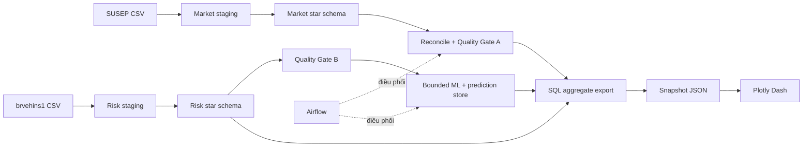

<p align="center"></p>

<p align="center">
  
  
  
  
  
</p>

<p align="center"><b>Kho dữ liệu bảo hiểm, kiểm soát chất lượng và phân tích rủi ro — từ CSV đến dashboard web.</b></p>
<p align="center"><a href="#chạy-nhanh">Chạy nhanh</a> · <a href="GUIDE.md">Học và vận hành</a> · <a href="CHANGELOG.md">Bằng chứng & lịch sử</a> · <a href="AGENTS.md">Bàn giao AI</a></p>

## Dự án này làm gì?

Đây là **dự án cá nhân về Data Engineering**: nạp hơn 10,3 triệu quan sát bảo hiểm vào SQL Server, xây star schema và quality gates, điều phối bằng Airflow, triển khai mô hình HasClaim có giới hạn tài nguyên và trình bày bằng **Plotly Dash**. Dự án tập trung vào pipeline có thể chạy lại, dữ liệu có thể đối soát và quyết định kỹ thuật có bằng chứng.

Hai nhánh phân tích giữ riêng ý nghĩa nguồn:

- **Track A — SUSEP Market:** 8.338.214 dòng theo công ty/tháng/sản phẩm/bang, phục vụ phí bảo hiểm, bồi thường và tối ưu truy vấn. Dữ liệu 01/2003–07/2023.
- **Track B — brvehins1 Motor Risk:** 1.965.355 quan sát tổng hợp, phục vụ risk analytics và ML. Mô hình chấm 20.000 dòng held-out; ROC-AUC 0,809 và Average Precision 0,514 trên test lịch sử.

Hai nguồn không có khóa khách hàng/hợp đồng chung; nền tảng giữ hai star schema độc lập. Prudential là hướng dự kiến chưa có dữ liệu. Contract và cách diễn giải đúng nằm trong [GUIDE](GUIDE.md#6-hợp-đồng-nguồn-và-từ-điển-dữ-liệu).

## Dashboard


Ba trang phân tích thống nhất, dùng sidebar, KPI và biểu đồ tương tác:

- **Thị trường bảo hiểm:** lọc bang/giai đoạn, xu hướng tháng, doanh nghiệp và sản phẩm dẫn đầu, tải aggregate CSV.
- **Motor Risk & ML:** exposure, claim frequency, phân bố score, kết quả HasClaim theo nhóm và dải điểm; filter riêng của Track B.
- **Chất lượng & Hiệu năng:** đối soát count staging/fact và bằng chứng tối ưu SQL trước/sau index.

Dashboard đọc **snapshot aggregate từ SQL thật** trong [data/dashboard.json](data/dashboard.json), có thời điểm xuất hiển thị rõ trên trang. Chạy demo không cần Power BI, SQL credential hoặc CSV gốc. Muốn làm mới dữ liệu, chạy export sau pipeline rồi tải lại trang. Các metric ML/performance lịch sử được ghi nhãn riêng; dashboard không phải dữ liệu realtime.

## Chạy nhanh

Cần Python 3.12. Trong PowerShell tại thư mục repo:

```powershell
py -3.12 -m venv .venv
.venv\Scripts\python.exe -m pip install -r requirements.txt
.venv\Scripts\python.exe -m dashboard.app
```

Mở **[http://127.0.0.1:8050](http://127.0.0.1:8050)**. Nếu đã có `.venv`, dùng lại môi trường hiện hữu.

Muốn chạy SQL Server và pipeline đầy đủ, cài Docker Desktop + ODBC Driver 18, đặt nguồn đúng contract, rồi:

```powershell
Copy-Item .env.example .env
# Điền secret local vào .env trước khi chạy Docker.
docker compose up -d sqlserver
.venv\Scripts\python.exe pipeline/manage.py migrate
.venv\Scripts\python.exe pipeline/manage.py load-market
.venv\Scripts\python.exe pipeline/manage.py load-risk
.venv\Scripts\python.exe pipeline/manage.py quality
```

Lần clone mới không gồm raw/model binary. Xem [cài đặt đầy đủ, scoring và export](GUIDE.md#5-cài-đặt-và-chạy) trước khi chạy những bước cần dữ liệu. Database hiện có sẽ skip migration/batch đã thành công; không cần train lại model chỉ để mở dashboard.

Docker có hai profile tùy chọn:

```powershell
docker compose --profile analytics up -d --build dashboard
docker compose --profile orchestration up -d --build airflow
```

Dash ở 8050, Airflow ở 8080. Chọn một cách chạy dashboard trên 8050. Giữ volume `sqlserver_data`; xem [Docker lưu gì và cách dừng an toàn](GUIDE.md#4-docker-thực-sự-lưu-gì).

## Kiến trúc



Python streaming giữ RAM có giới hạn và lineage; SQL Server chịu trách nhiệm kiểu dữ liệu, dimensions/facts, DQ và index; Airflow điều phối hai nhánh độc lập. Dash đọc snapshot để không quét toàn fact khi người dùng đổi bộ lọc. [GUIDE](GUIDE.md#2-luồng-dữ-liệu-từ-đầu-đến-cuối) giải thích từng bước bằng ngôn ngữ đơn giản.

## Cấu trúc repository

```text
dashboard/      Dash app, bộ lọc, biểu đồ, CSS và hình minh họa
pipeline/       Ingest, profiling, ML, export, CLI và DAG Airflow
database/       Migration V1–V14 và workload performance SQL
infra/          Dockerfile và dependency của container
data/           Raw/model local, output sinh lại, snapshot và evidence
tests/          Kiểm tính nhất quán dữ liệu và thao tác trình duyệt
```

Chỉ bốn tài liệu chính ở root: **README** để giới thiệu, **[GUIDE](GUIDE.md)** để học/vận hành/phỏng vấn, **[CHANGELOG](CHANGELOG.md)** để đọc lịch sử/bằng chứng và **[AGENTS](AGENTS.md)** cho AI tiếp quản. Không cần lần theo nhiều thư mục docs/report cũ.

## Kết quả có thể kiểm chứng

- Staging/fact khớp 8.338.214 dòng Track A và 1.965.355 dòng Track B; hai executable quality gate chạy được trên SQL thật.
- Batch scoring held-out 20.000 dòng, khóa technical identity/model/population chống nhân đôi khi rerun.
- Hai covering indexes giảm logical reads **98,94%** và **98,82%** cho hai workload SUSEP đã đo; đổi lại khoảng 924,51 MB storage và thêm chi phí ghi.
- Airflow đã có happy path 12/12 task và controlled failure chặn đúng consumer của track lỗi trong bằng chứng lịch sử.
- Dashboard thay Power BI bằng app có thể chạy từ snapshot đi kèm; không cần artifact `.pbix` hoặc GUI desktop.

Xem ngày đo, run ID và phân biệt bằng chứng hiện tại/lịch sử trong [CHANGELOG](CHANGELOG.md). Các kết quả này không phải cam kết production: nguồn B thiếu event time, model chỉ cross-sectional association, Airflow standalone dùng SQLite, chưa có auth/RBAC cho dashboard và chưa nghiệm thu fresh rebuild phá hủy dữ liệu trong phiên dọn repo.

## Kiểm tra

```powershell
.venv\Scripts\python.exe -m pip install -r requirements-dev.txt
.venv\Scripts\python.exe pipeline/validate_repo.py
.venv\Scripts\python.exe -m unittest discover -s tests -p test_*.py
docker compose --profile analytics --profile orchestration config -q
git diff --check
```

App đang chạy + Microsoft Edge: `python tests/browser_check.py` kiểm ba trang, filter năm/bang, CSV và màn hình nhỏ. Kiểm SQL hiện có: `python pipeline/manage.py status`, `quality`, `export`. [Xử lý sự cố](GUIDE.md#13-kiểm-tra-và-xử-lý-lỗi) có giải thích ODBC, port, credential, model và snapshot.

## Dữ liệu và giấy phép

`.env`, raw CSV, model binary, môi trường Python và output runtime nằm ngoài Git. Repo giữ SQL/Python, tài liệu và aggregate snapshot; không nhúng secret trong app. Quyền sử dụng dữ liệu nguồn cần được kiểm theo nơi cung cấp, độc lập với giấy phép mã nguồn [LICENSE](LICENSE).
