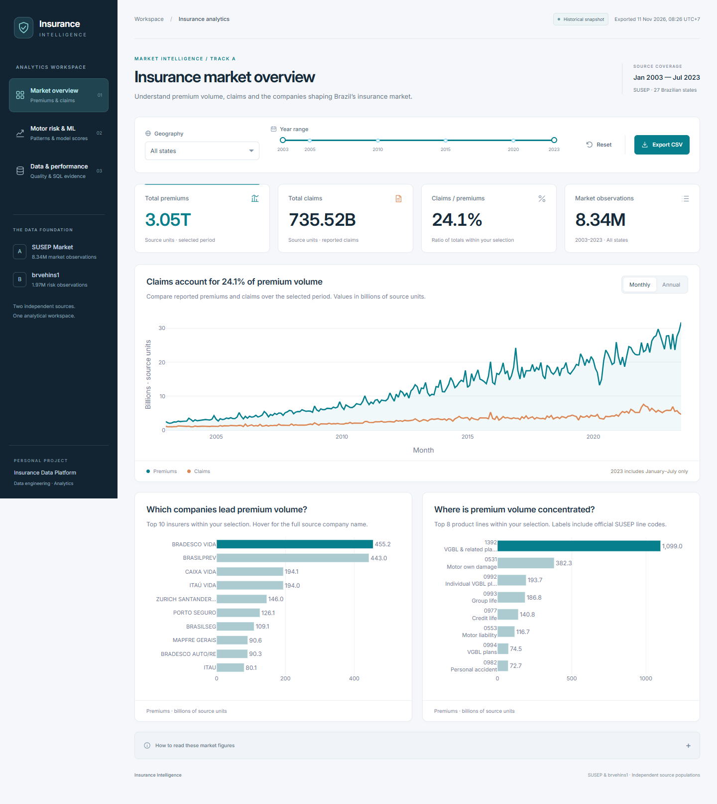

<p align="center">
  
</p>

<p align="center">
  
  
  
  
  
</p>

<p align="center"><strong>Từ CSV bảo hiểm đến kho dữ liệu có kiểm soát chất lượng, mô hình rủi ro và dashboard tương tác.</strong></p>

<p align="center">
  <a href="#dashboard"><strong>↗ Xem dashboard</strong></a>
  &nbsp;&nbsp;·&nbsp;&nbsp;
  <a href="#architecture"><strong>◇ Xem sơ đồ dự án</strong></a>
</p>

> **Liên kết dashboard công khai:** đang chờ triển khai. Nút trên dẫn tới ảnh xem trước và cách chạy local; sau khi có URL Vercel, thay `href="#dashboard"` bằng URL thật. Ứng dụng Dash hiện chạy bằng Python/Gunicorn; triển khai Vercel cần kiểm tra runtime và chức năng export, chưa được xác nhận trong repo này.

## Tổng quan

**Insurance Data Platform** là dự án cá nhân về data engineering và analytics. Python nạp dữ liệu theo batch; SQL Server giữ staging, star schema, kiểm tra chất lượng và prediction; Airflow điều phối; Plotly Dash đọc một snapshot aggregate có ghi thời điểm xuất. Dashboard không truy vấn hàng triệu dòng mỗi lần đổi bộ lọc.

- **Track A · SUSEP Market:** 8.338.214 dòng theo *công ty × tháng × sản phẩm × bang*, giai đoạn 01/2003–07/2023. Phục vụ phân tích premium, claims, loss ratio và hiệu năng truy vấn.
- **Track B · brvehins1 Motor Risk:** 1.965.355 quan sát rủi ro tổng hợp trong năm CSV. Phục vụ phân tích exposure, claim frequency và mô hình liên hệ với `HasClaim`.

Hai nguồn có **grain và danh tính khác nhau**. Không có khóa chung được chứng minh để join từng dòng; dự án giữ hai nhánh warehouse độc lập. Prudential là hướng tương lai, **chưa có raw data hoặc pipeline**.

<a id="architecture"></a>
## Sơ đồ kiến trúc

<p align="center">
  
</p>

**Đọc sơ đồ từ trái sang phải:** CSV gốc → Python ingest → SQL staging/star schema → quality gate → aggregate hoặc scoring → snapshot JSON → Dash. Airflow chạy thứ tự công việc, Docker Compose chạy các dịch vụ local. Đường nối ở cuối chỉ gom **kết quả tổng hợp** cho giao diện, không phải join hai nguồn ở mức bản ghi.

### Các lớp dữ liệu

1. **Nguồn và nạp dữ liệu:** `pipeline/load_market.py` và `load_risk.py` đọc CSV theo batch, kiểm header/kiểu và giữ lineage (`SourceFile`, số dòng, hash, batch). Raw chỉ đọc và không nằm trong Git.
2. **SQL Server:** schema `stg` giữ dữ liệu nạp; `dwh` giữ dimension/fact của hai track; `meta` ghi version và batch; `dq` chạy quality gate. File SQL trong repo tạo schema, còn **database thật nằm trong Docker volume**.
3. **Phân tích:** Track A đối soát raw/staging/fact và tính aggregate thị trường. Track B có bảng prediction cho 20.000 dòng held-out; model binary nằm local, không được tự train khi mở dashboard.
4. **Phục vụ giao diện:** `pipeline/export_dash.py` xuất các bảng aggregate vào `data/dashboard.json`. Dash lọc và vẽ từ snapshot này; muốn thấy dữ liệu SQL mới phải chạy `export` rồi tải lại trang.

<a id="dashboard"></a>
## Dashboard

<p align="center">
  
</p>

Giao diện **tiếng Anh**, có bộ lọc riêng cho từng nguồn, KPI giải thích rõ phạm vi, biểu đồ tương tác và bố cục cho desktop/mobile:

- **Market overview:** premium, claims, ratio, top company/product; lọc bang và năm; đổi Monthly/Annual; tải CSV aggregate theo bộ lọc.
- **Motor risk & ML:** exposure, claim frequency, phân bố score và so sánh score với `HasClaim` quan sát. ROC-AUC/AP là số đo lịch sử của toàn bộ held-out, không đổi theo filter.
- **Data & performance:** bảng đối soát staging/fact và benchmark SQL có ghi ngày đo; biểu đồ nêu cả lợi ích đọc dữ liệu và chi phí lưu index.

Ảnh trên chụp ứng dụng chạy từ snapshot xuất từ SQL thật vào **11/11/2026**. Dashboard không realtime, không cần credential SQL để xem local. CSV tải xuống là **aggregate đã lọc**, không phải raw CSV hay toàn bộ prediction.

### Chạy nhanh từ snapshot đi kèm

Cần **Python 3.12**. Mở PowerShell tại root repository:

```powershell
py -3.12 -m venv .venv
.venv\Scripts\python.exe -m pip install -r requirements.txt
.venv\Scripts\python.exe -m dashboard.app
```

Mở `http://127.0.0.1:8050`. Nếu `.venv` đã có, bỏ qua bước tạo venv. Cách này dùng `data/dashboard.json`; **không cần** SQL Server, raw CSV, `.env` hoặc model binary.

## Chạy toàn bộ pipeline

Phần này cần **Docker Desktop**, **ODBC Driver 18 for SQL Server** trên host, Python 3.12 và CSV đúng contract. Không cần các thành phần đó nếu chỉ xem dashboard.

### 1. Cấu hình và khởi động SQL Server

```powershell
if (-not (Test-Path .env)) { Copy-Item .env.example .env }
# Mở .env và điền SQLSERVER_SA_PASSWORD mạnh, chỉ giữ trên máy.
docker compose up -d sqlserver
docker compose logs --tail 30 sqlserver
.venv\Scripts\python.exe pipeline/manage.py migrate
```

Đợi SQL Server sẵn sàng trước khi migrate. `.env.example` mô tả cả biến tùy chọn; `.env` có thể chỉ gồm `SQLSERVER_SA_PASSWORD`. `pipeline/config.py` mặc định host `localhost,1433`, database `DWH_Insurance` và user `sa`. Nếu volume SQL đã tồn tại, dùng **mật khẩu cũ**; đổi `.env` không đổi mật khẩu trong database. Migration V1–V14 chạy theo số và skip version đã ghi nhận.

### 2. Đặt nguồn và nạp kho dữ liệu

```text
data/raw/susep.gov.br/insurance_dataset.csv
data/raw/brvehins1/brvehins1a.csv ... brvehins1e.csv
```

```powershell
.venv\Scripts\python.exe pipeline/validate.py --raw
.venv\Scripts\python.exe pipeline/manage.py load-market
.venv\Scripts\python.exe pipeline/manage.py load-risk
.venv\Scripts\python.exe pipeline/manage.py quality
.venv\Scripts\python.exe pipeline/manage.py status
.venv\Scripts\python.exe pipeline/reconcile_market.py
```

Loader bỏ qua batch cùng fingerprint đã hoàn tất. Lần đầu có thể mất thời gian vì hơn 10 triệu dòng. Hai quality gate SQL cần PASS trước khi coi dữ liệu sẵn sàng cho phân tích; `status` chỉ đếm dòng, không thay thế quality gate.

### 3. Score và cập nhật dashboard

```powershell
.venv\Scripts\python.exe pipeline/manage.py score
.venv\Scripts\python.exe pipeline/manage.py export
```

`score` cần artifact model local tại `data/models/claim_risk_model_v001.joblib` và warehouse Track B đã nạp. Artifact **không có trong bản clone công khai**. Huấn luyện mới là tác vụ riêng qua `pipeline/train_risk.py`, chỉ chạy khi chủ động đánh giá lại model. Bản clone không có artifact vẫn xem được snapshot đi kèm.

### Tùy chọn: Dashboard và Airflow qua Docker

```powershell
docker compose --profile analytics up -d --build dashboard
docker compose --profile orchestration up -d --build airflow
```

Dash dùng cổng `8050`, Airflow dùng `8080`, SQL Server dùng `1433`, tất cả bind local `127.0.0.1`. Chỉ chạy **một** dashboard trên cổng 8050. Compose đọc `.env` để nội suy password SQL ngay cả khi chỉ bật profile analytics.

Airflow DAG `insurance_data_platform` có `schedule=None`: bật và trigger thủ công trong UI. Nhánh A nạp/đối soát/DQ; nhánh B kiểm foundation đã có/DQ/score/kiểm prediction. DAG **không tự nạp Track B lần đầu, không train model, không export snapshot**. Task phụ thuộc chỉ chạy sau khi task trước thành công; hai nhánh không cần join dữ liệu.

## Data contract

- **SUSEP:** header phải là `company_code,company_name,year_month,product,state,premiums,claims,claim_premium_ratio`. Một dòng là một tổ hợp company/month/product/state. `premiums` và `claims` là aggregate nguồn; raw text được giữ để audit, số phân tích dùng `DECIMAL(38,18)` với chính sách làm tròn đã định. `claim_premium_ratio` có thể `NA`; loss ratio trên dashboard được tính từ `SUM(claims) / SUM(premiums)` khi mẫu số dương.
- **brvehins1:** 23 cột mô tả driver/vehicle/geography, exposure, premium và năm nhóm claim. Một dòng là **quan sát rủi ro tổng hợp**, không mặc định là một khách hàng, hợp đồng hay claim event. `HasClaim = 1` khi tổng năm `ClaimNb* > 0`; claim frequency = tổng số claim / exposure khi exposure dương. Dòng trùng nội dung vẫn có lineage riêng.
- **ML:** feature chỉ dùng `Gender`, `DrivAge`, `VehYear`, `VehModel`, `VehGroup`, `Area`, `StateAb`. Split theo `SourceRecordHash` để hạn chế rò rỉ bản ghi trùng. Mẫu 100.004 dòng có giới hạn tài nguyên; test held-out 20.000 dòng. Nguồn B không có thời điểm sự kiện nên model chỉ là **cross-sectional HasClaim association**, không phải xác suất underwriting tương lai.

Đơn vị tiền SUSEP chưa được xác nhận đầy đủ; giao diện ghi **source units**, không gắn BRL. Năm 2023 của SUSEP chỉ có đến tháng 07, nên tổng năm đó là phần năm.

## Cấu trúc repository

```text
dashboard/   Ứng dụng Dash, CSS, ảnh giao diện và sơ đồ kiến trúc
pipeline/    Ingest, profiling, quality orchestration, ML, export và CLI
database/    Migration V1–V14 và SQL benchmark
infra/       Dockerfile và dependency riêng cho Dash/Airflow
data/        Snapshot/evidence công khai; raw, model, output chỉ ở local
tests/       Unit tests và kiểm tra trình duyệt
```

`docker-compose.yml` ở root để nhìn thấy ngay cách chạy hệ thống; Dockerfile ở `infra/`. `data/` là nơi đặt **file đầu vào/đầu ra**; `database/` là **mã SQL tạo và nâng cấp database**. Dữ liệu SQL thật nằm trong named volume `sqlserver_data` tại `/var/opt/mssql`, không nằm trong hai thư mục đó. `airflow_state` giữ metadata SQLite local của Airflow; `airflow_logs` giữ task logs. `data/raw` và `data/models` được mount chỉ đọc vào container cần dùng.

`docker compose stop` chỉ dừng service; `docker compose down` giữ named volumes mặc định. **Không dùng `docker compose down -v` nếu cần giữ database.** Giữ cùng Compose project name khi khởi động lại để dùng đúng volume; Git không phải bản backup SQL.

## Kết quả và kiểm chứng

- **11/11/2026:** staging và fact khớp 8.338.214 dòng Track A và 1.965.355 dòng Track B; hai SQL quality gate PASS. Airflow `dags test` hoàn tất **12/12 task**, là lần chạy kiểm thử CLI, không phải scheduler production.
- **09/2026, model held-out lịch sử:** ROC-AUC **0,808815**, Average Precision **0,513523**, positive prevalence **18,845%** trên 20.000 dòng. Đây là số đo của artifact hiện có, không phải kết quả train mới hoặc metric theo filter dashboard.
- **24/09/2026, benchmark SQL lịch sử:** hai covering indexes giảm logical reads **98,94%** và **98,82%** cho hai workload SUSEP đã đo; cần thêm khoảng **924,51 MB** index và chi phí ghi. Không suy rộng sang mọi truy vấn.
- **11/11/2026, giao diện:** 5 unit tests và kiểm tra Edge/Playwright trên desktop/mobile, bộ lọc, CSV, PNG và health endpoint PASS. Snapshot có `exported_at_utc`; xem chính thời điểm đó trên dashboard để biết độ mới của số liệu.

Chạy lại phần kiểm tra có thể thực hiện local:

```powershell
.venv\Scripts\python.exe -m pip install -r requirements-dev.txt
.venv\Scripts\python.exe pipeline/validate.py
.venv\Scripts\python.exe -m unittest discover -s tests -p test_*.py
docker compose --profile analytics --profile orchestration config -q
```

Khi app đã chạy và có Microsoft Edge, dùng `.venv\Scripts\python.exe tests/browser_check.py` để kiểm giao diện. `data/evidence.json` giữ evidence máy đọc của các lần chạy đã ghi; các phép đo lịch sử không được xem là phép đo mới. Chưa nghiệm thu fresh rebuild/restore cô lập, dashboard chưa có auth/RBAC, Airflow dùng standalone/SQLite cho local.

## Giấy phép và dữ liệu

Mã nguồn theo [LICENSE](LICENSE). `.env`, CSV gốc, model binary, runtime output và venv không được đưa lên Git. Dùng dữ liệu nguồn theo quyền của nơi cung cấp; snapshot đi kèm chỉ gồm aggregate phục vụ trình diễn.
