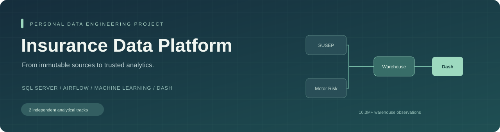
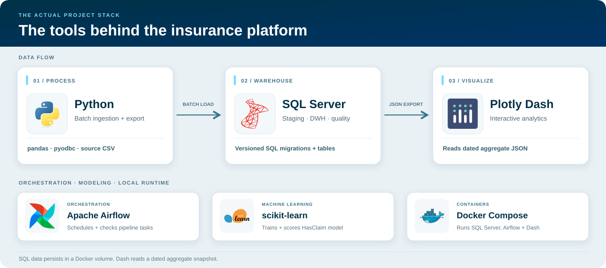
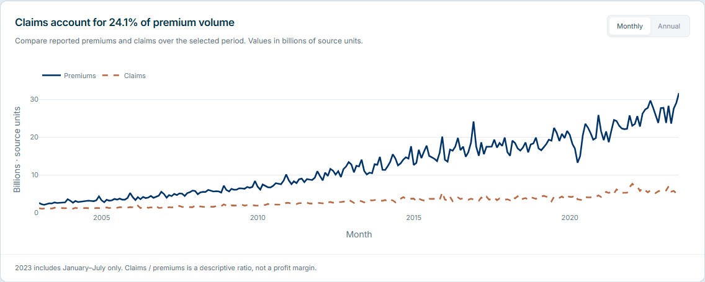
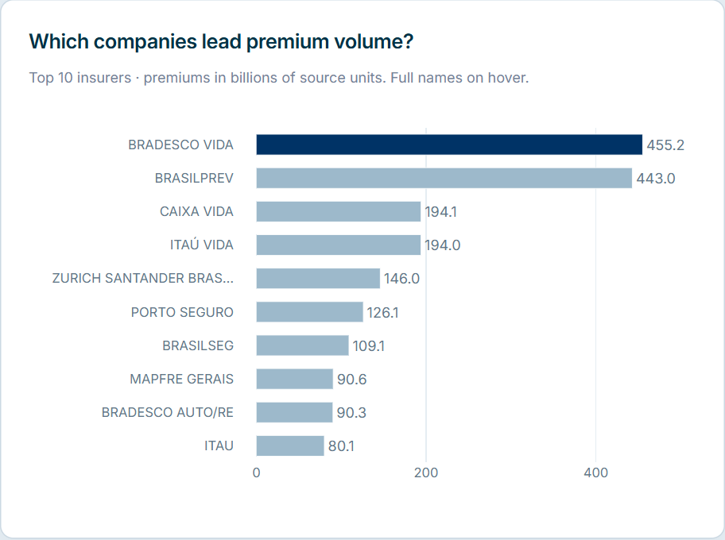
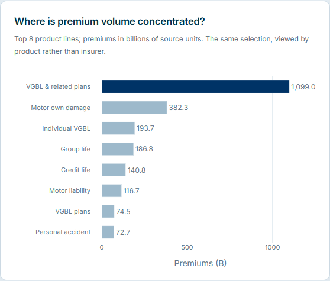
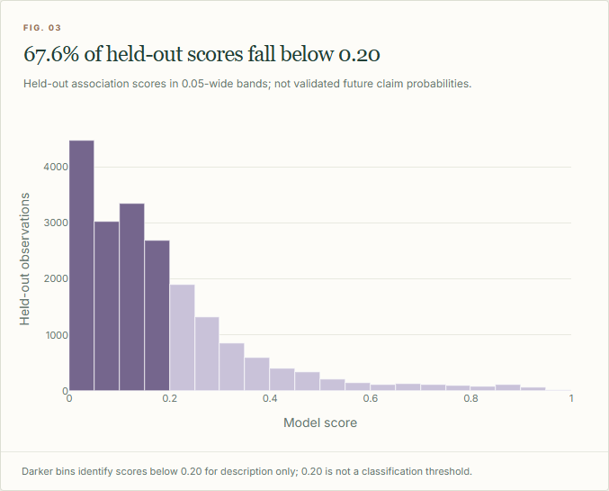
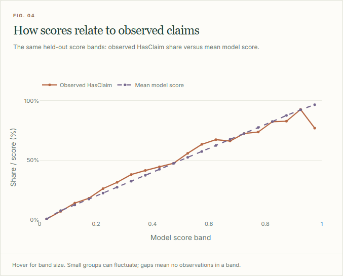
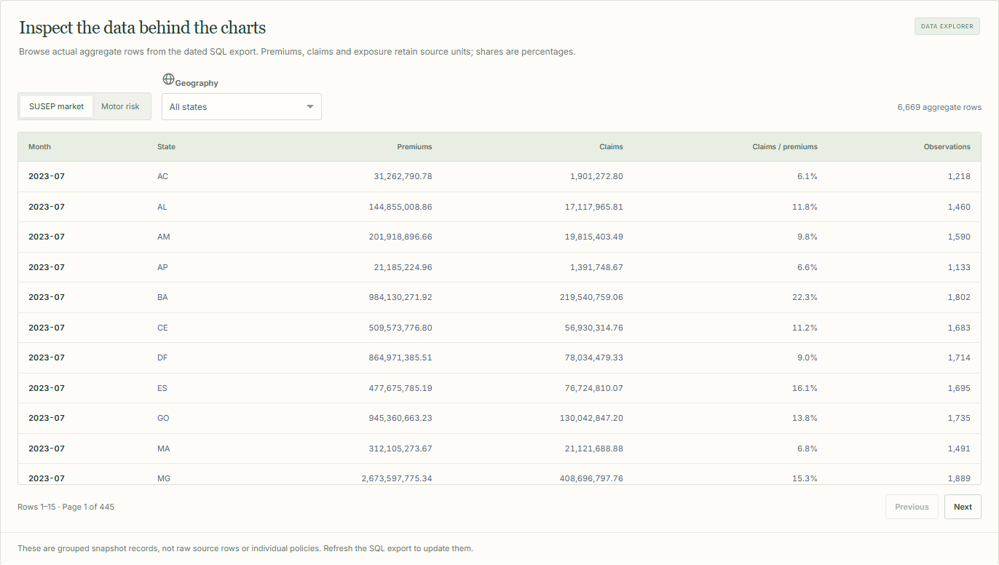
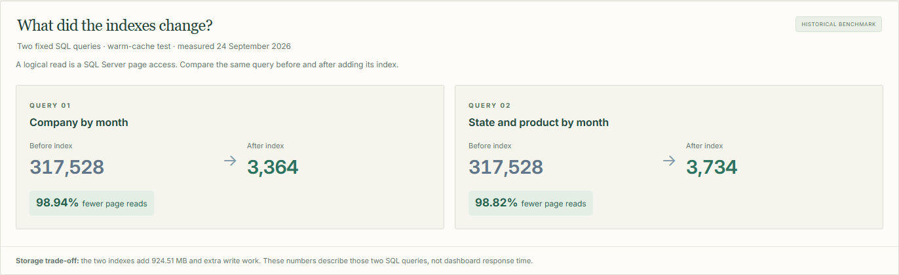

<p align="center">
  
</p>

<p align="center">
  
  
  
  
  
</p>

<p align="center"><strong>A batch data engineering platform: auditable ingestion, dimensional warehousing, quality gates, and analytics delivery.</strong></p>

<p align="center">
  <a href="#data-engineering">Explore the engineering</a> ·
  <a href="#dashboard-stories">View the insights</a> ·
  <a href="#quick-start">Run the dashboard</a> ·
  <a href="#technology-map">View the technology map</a>
</p>

## What this project does

Insurance Data Platform is a personal **Data Engineering project** that turns insurance CSVs into traceable warehouse data and published analytical datasets. Its engineering work covers source contracts, bounded batch ingestion, lineage, repeatable loads, dimensional modeling, SQL quality gates, orchestration, and query tuning. The dashboard and bounded ML workflow are consumers of that foundation.

The warehouse contains **10,303,569 observations across two independent tracks**. Python loads the files, SQL Server stores staging and dimensional tables, and Airflow coordinates the implemented tasks. Plotly Dash reads an exported aggregate snapshot, so changing a filter does not scan millions of SQL rows.

The two sources answer different questions:

- **Track A — SUSEP insurance market:** 8,338,214 rows at company × month × product × state grain, from January 2003 through July 2023. It supports premium, claims, product mix, and SQL performance analysis.
- **Track B — brvehins1 motor risk:** 1,965,355 aggregate risk observations across five CSV files. It supports exposure and observed claim analysis, plus a bounded `HasClaim` model evaluation.

The sources have different grains and no demonstrated shared customer, policy, or claim identity. Their warehouse tracks remain independent; there is no row-level join. Prudential is a future idea with no raw data or implemented pipeline.

## Technology map

<p align="center">
  
</p>

Python and pandas load and aggregate data; SQL Server stores and checks it; Plotly Dash presents the exported JSON snapshot. Airflow coordinates local jobs, scikit-learn supports the separately run model workflow, and Docker Compose starts the local services. The diagram shows the tools used in this repository, not a join between its two data sources.

## Data Engineering

### Ingestion, source contracts, and lineage

The [market loader](pipeline/load_market.py) and [motor risk loader](pipeline/load_risk.py) stream CSV records and send bounded batches through `pyodbc.fast_executemany`. Headers, required fields, numeric values, and expected source row counts are validated. Raw files stay unchanged; staging and fact records carry batch IDs, source filenames, row numbers, record hashes, and load timestamps so an unexpected measure can be traced back to its input.

- **SUSEP source versions:** a file SHA-256 identifies the source version. A completed version can be skipped on rerun after checking its accepted/rejected row counts. Invalid rows retain their payload and rejection reason in a separate staging table; the quality gate requires the canonical source to have no rejected rows. Interrupted or failed loads have source-version cleanup logic before retrying.
- **Motor risk partitions:** the canonical manifest defines the five expected files. A file with an existing successful batch is skipped; row identity is `SourceFile + SourceRowNumber`, while `SourceRecordHash` records the source values. Invalid input fails the load and rolls back its uncommitted staging inserts. This is an immutable-file workflow; its skip check is not a detector for revised contents under the same filename.
- **Concurrency and audit:** both loaders acquire SQL application locks for the source file and record batch status, row counts, duration, and failures in metadata/audit tables. These controls make the supported rerun behavior explicit; they do not establish a universal exactly-once guarantee.

### Dimensional warehouse and schema evolution

The database separates responsibilities into `stg` for ingestion, `dwh` for dimensional facts and dimensions, `meta` for ingestion/schema history, and `dq` for quality results. Track A models company, month, product, and state around `FactSusepInsuranceMarket`; Track B models driver profile, vehicle, and geography around `FactRiskObservation`.

Fact loaders use transactions, source lineage, foreign keys, uniqueness constraints, and checks for already loaded staging rows. The design preserves each source's grain. It does not invent customer/policy identities or SCD Type 2 history where the source cannot support them. The [versioned migrations](database/migrations) retain **V1–V14**; the [management CLI](pipeline/manage.py) applies them in numeric order and skips recorded versions. Future schema changes belong in new migrations.

### Quality gates and reconciliation

The [motor risk gate](database/migrations/V8__create_data_quality_gate.sql) and [SUSEP gate](database/migrations/V13__create_susep_quality_gate.sql) persist rule outcomes in SQL. Checks cover source/staging/fact reconciliation, technical identities, required fields, dimension relationships, and source-specific rules. SUSEP also has a [direct raw-to-staging-to-fact reconciler](pipeline/reconcile_market.py).

Hard rule failures raise SQL `THROW`; the CLI and DAG drain all result sets so a terminal error reaches Python and fails the task. SUSEP negative amounts and source `NA` ratios are recorded as warnings rather than silently changed. This separates source fidelity from rules that must block consumption. The latest recorded warehouse run on **11 November 2026** passed both gates and reconciled **8,338,214** market and **1,965,355** risk rows.

### Orchestration and controlled data delivery

The [Airflow DAG](pipeline/dag.py) defines task dependencies, one retry, and a one-minute retry delay. Track A runs ingestion, warehouse loading, direct reconciliation, and its quality gate. Track B checks the existing foundation and batch audit, runs its quality gate, scores the existing held-out population, and validates prediction identities. A hard quality failure blocks downstream tasks in its branch. The recorded CLI DAG test completed **12/12 tasks**; the DAG is manually triggered with `schedule=None`.

The [snapshot exporter](pipeline/export_dash.py) reads the aggregate tables in one `SERIALIZABLE` transaction, checks aggregate observation counts against fact counts, adds a schema version and export timestamp, and replaces the destination JSON atomically. Serializable reads can block concurrent writes; that is an explicit trade-off in this local batch design. Dash serves the resulting aggregate file without a SQL credential. Dashboard export remains a separate CLI step after quality checks; the DAG does not yet publish it automatically.

### Performance, operations, and engineering evidence

- **Query tuning:** [benchmark SQL](database/performance.sql) and two covering indexes support the measured SUSEP workloads. The **24 September 2026** benchmark recorded **98.94% / 98.82% fewer logical reads**, with **924.51 MB** of added index storage and write overhead. These are historical, workload-specific measurements.
- **Repeatable local services:** [Docker Compose](docker-compose.yml) defines SQL Server, Dash, and Airflow profiles; [Dockerfiles](infra) and pinned dependencies describe their environments. Database, Airflow metadata, and task logs use persistent named volumes.
- **Validation:** [static validation](pipeline/validate.py), [unit tests](tests/test_platform.py), and [browser checks](tests/browser_check.py) cover the maintained layout, aggregate integrity, migration ordering, filters, exports, and responsive views. Tests also reconcile score-bin counts and observed outcomes, check filtered reference rates, and verify the recorded before/after SQL read counts. Automated CI and an isolated fresh database rebuild/restore are still planned.
- **Scope of change capture:** [the CDC demonstration](pipeline/cdc_demo.py) is an isolated controlled example. The two real source pipelines currently ingest immutable CSV batches; they do not capture live operational changes.

## Dashboard stories

These are **individual views from the English-language Dash app**, captured from the SQL export dated **11 November 2026**. They show the unfiltered default view. Choose a state or year range in the app to ask a narrower question; the screenshot findings below describe only the displayed population. The dashboard is a snapshot, not a live SQL view. For a page-by-page narrative in Vietnamese, read [the dashboard story guide](dashboard/STORY.md).

The [visualization guide and chart audit](dashboard/VISUALIZATION_GUIDE.md) trace the design to seven course PDFs: chart purpose, honest axes, continuous score bins, color meaning, and a connected narrative. Source-backed theory, inferred applications, and implementation choices are labeled separately. The Motor risk page first shows the full warehouse population, then a visibly separate held-out evaluation; filter controls update each within its own scope.

### Market overview · Track A

#### How have premiums and claims changed?

<p align="center"></p>

**Insight:** Premium volume rises over much of the series while claims remain below premiums. Across the full selected period, premiums total **3.05 trillion** and claims **735.52 billion** in *source units*, giving a **24.1% claims-to-premiums ratio**. The latest comparable period, January–July 2023 versus January–July 2022, has **8.9% higher premiums**, **11.9% lower claims**, a **4.9 percentage-point lower ratio**, and **13.0% fewer reported rows**. All four Market KPI badges compare the same months and state; green means a numerical increase, red a decrease, and dark means no valid comparison or no change. A lower claims or row count is not automatically better or worse. The chart can switch between monthly and annual aggregation; 2023 contains only January–July, so its annual point is a partial year. This ratio is a descriptive aggregate, not a profit margin.

#### Which companies account for the most premium volume?

<p align="center"></p>

**Insight:** BRADESCO VIDA and BRASILPREV lead this selection at approximately **455.2 billion** and **443.0 billion** source units. Their shares of total premium volume are about **14.9%** and **14.5%**. Ranking is based on the selected years and state; hover in the app for full source names. A large volume does not establish a better claims result.

#### Which product lines dominate the mix?

<p align="center"></p>

**Insight:** “VGBL & related plans” is the largest displayed line at about **1.10 trillion** source units, or **36.0%** of all selected premiums. “Motor own damage” follows at about **382.3 billion**. These are source product categories; the app keeps source codes and full names in hover details. Concentration is a volume observation, not a forecast.

### Motor risk and model · Track B

#### Where do held-out model scores fall?

<p align="center"></p>

**Insight:** **13,526 of 20,000 held-out observations (67.6%)** have a model score below 0.20. The chart describes the score distribution of a bounded, historical evaluation sample. It does not display scores for every warehouse row, and the scores are not validated probabilities of future claims.

#### Do higher score bands contain more observed claims?

<p align="center"></p>

**Insight:** In the held-out sample, the combined bands below 0.20 have **8.8%** observed `HasClaim`, while bands from 0.50 upward have **69.9%** across **1,091** observations. The chart compares the observed share with the mean score within each band; small high-score bands can be noisy. This is cross-sectional association, not a future underwriting probability or evidence of causality. The historical full-sample ROC-AUC is **0.808815** and average precision is **0.513523**; those metrics do not change with the dashboard's state filter.

### Data quality and performance

#### Which data rows feed the dashboard?

<p align="center"></p>

**Insight:** The Data tab now exposes the dated SQL snapshot's **6,669** market month/state aggregates or **644** motor risk segments. Switch source, filter by state, and page through 15 rows at a time. The market view shows premiums, claims, their ratio, and observation counts. The motor view shows exposure, claim counts, and observed `HasClaim` share by state, source gender label, and age group. These rows are aggregates; they are not the private raw records or individual customers and policies.

#### What did the SQL indexes improve, and what did they cost?

<p align="center"></p>

**Insight:** In a **24 September 2026** warm-cache benchmark, two covering indexes reduced logical reads by **98.94%** for the company/month workload and **98.82%** for the state/product/month workload. They also added approximately **924.51 MB** of index storage and write overhead. Logical reads measure SQL page accesses; this is historical evidence for those two queries, not a new benchmark or an end-to-end dashboard speed test. The Data tab's KPI also shows staging/fact row-count reconciliation from the current snapshot.

The comparison shows the exact before and after counts: **317,528 → 3,364** page reads for the company/month query, and **317,528 → 3,734** for the state/product/month query. It pairs each reduction with its query name and keeps the **924.51 MB** storage trade-off visible. Across the app, premiums use forest green, observed claims use terracotta, model scores use purple, and observation counts use gray. Market KPI arrows, values, and badge colors indicate numerical direction only.

The app also includes age-group and profile-label views, per-track filters and resets, CSV exports of **filtered aggregates**, and Plotly PNG chart downloads. All four Market KPI comparison badges use matching calendar months in the prior year; the large values cover the full selected range. The risk tab separates full-warehouse observations from the 20,000-row held-out model sample.

## Quick start

**To view the bundled dashboard snapshot, you only need Python 3.12.** From the repository root in PowerShell:

```powershell
py -3.12 -m venv .venv
.venv\Scripts\python.exe -m pip install -r requirements.txt
.venv\Scripts\python.exe -m dashboard.app
```

Open **http://127.0.0.1:8050**. If the virtual environment already exists, skip its creation. This path reads `data/dashboard.json` and needs no SQL Server login, raw CSV, `.env`, or private model binary. Stop the app with `Ctrl+C`. To refresh the displayed data after a new SQL load, run `export` in the full pipeline below and reload the page. No public dashboard URL is configured yet.

## Run the full pipeline

This path requires **Docker Desktop**, **Python 3.12**, **Microsoft ODBC Driver 18 for SQL Server on the host**, and the source CSVs described below. Run commands from the repository root. Use the same virtual environment and installed `requirements.txt` from Quick start.

### 1. Configure and start SQL Server

```powershell
if (-not (Test-Path .env)) { Copy-Item .env.example .env }
# Edit .env and set SQLSERVER_SA_PASSWORD to a strong local password.
docker compose up -d sqlserver
docker compose logs --tail 30 sqlserver
.venv\Scripts\python.exe pipeline/manage.py migrate
```

Wait until SQL Server is ready before migration. `.env.example` lists optional settings; `.env` can contain only `SQLSERVER_SA_PASSWORD` because host (`localhost,1433`), database (`DWH_Insurance`), and user (`sa`) have defaults in `pipeline/config.py`. Keep `.env` private. An existing SQL volume retains its original `sa` password; editing `.env` alone does not change it. Migrations **V1–V14** run in numeric order and skip versions already recorded in SQL Server.

### 2. Supply and validate the source files

```text
data/raw/susep.gov.br/insurance_dataset.csv
data/raw/brvehins1/brvehins1a.csv
data/raw/brvehins1/brvehins1b.csv
data/raw/brvehins1/brvehins1c.csv
data/raw/brvehins1/brvehins1d.csv
data/raw/brvehins1/brvehins1e.csv
```

Raw files are local-only and must be left unchanged. Then run:

```powershell
.venv\Scripts\python.exe pipeline/validate.py --raw
.venv\Scripts\python.exe pipeline/manage.py load-market
.venv\Scripts\python.exe pipeline/manage.py load-risk
.venv\Scripts\python.exe pipeline/manage.py quality
.venv\Scripts\python.exe pipeline/manage.py status
.venv\Scripts\python.exe pipeline/reconcile_market.py
.venv\Scripts\python.exe pipeline/manage.py export
```

The first load can take time for more than ten million rows. SUSEP reruns identify completed source versions by file hash; motor risk reruns skip successful canonical filenames under the immutable-file contract described above. Both SQL quality gates must pass before treating the warehouse as ready; row counts from `status` alone are insufficient. `export` writes a new timestamped aggregate snapshot for Dash. Run it after the quality checks when data changes.

### 3. Optional model scoring and Airflow

```powershell
.venv\Scripts\python.exe pipeline/manage.py score
.venv\Scripts\python.exe pipeline/manage.py export
docker compose --profile orchestration up -d --build airflow
```

`score` needs the already trained local artifact at `data/models/claim_risk_model_v001.joblib` and a loaded Track B warehouse. That binary is **not included in a public clone**. Training is a separate, deliberate operation through `pipeline/train_risk.py`; running the dashboard never trains a model. Export again after scoring if you want the dashboard snapshot to reflect new prediction aggregates.

Airflow runs at **http://127.0.0.1:8080** using the `insurance_data_platform` DAG. The DAG has `schedule=None`: trigger it manually. Track A loads, reconciles, and quality-checks market data. Track B assumes its foundation and model already exist, then checks quality, scores, and verifies predictions. The DAG does **not** perform first-time Track B loading, model training, or dashboard export. Airflow uses a local standalone/SQLite setup here; its CLI test evidence is not a production scheduler run.

To run Dash in Docker instead of the Python command:

```powershell
docker compose --profile analytics up -d --build dashboard
```

Compose requires `SQLSERVER_SA_PASSWORD` in `.env` for configuration interpolation even when you start only the dashboard profile. Dash binds to **127.0.0.1:8050**, Airflow to **127.0.0.1:8080**, and SQL Server to **127.0.0.1:1433**. Only one dashboard process should use port 8050.

## Data contract and interpretation

- **SUSEP:** the CSV header must be `company_code,company_name,year_month,product,state,premiums,claims,claim_premium_ratio`. Each row is a company/month/product/state aggregate. Raw text remains available for audit; analyzed numeric values use a documented decimal rounding policy. Source `claim_premium_ratio` may be `NA`; the dashboard computes its displayed ratio as `SUM(claims) / SUM(premiums)` when total premiums are positive. The monetary unit has not been fully verified, so charts say **source units**, not BRL.
- **brvehins1:** 23 source fields describe driver, vehicle, geography, exposure, premium, and five claim groups. Each row is an **aggregate risk observation**, not necessarily one customer, policy, or claim event. `HasClaim` is true when the sum of the five `ClaimNb*` fields is positive. Claims/exposure is a claim-count frequency when exposure is positive. Identical source values retain separate lineage.
- **Model:** features are `Gender`, `DrivAge`, `VehYear`, `VehModel`, `VehGroup`, `Area`, and `StateAb`. The bounded sample has **100,004** rows, including a **20,000**-row held-out test set. Splitting by `SourceRecordHash` limits leakage from repeated records. There is no event timestamp in Track B, so the current model measures cross-sectional `HasClaim` association rather than prospective claim risk.

## Repository layout and storage

```text
dashboard/   Dash app, styling, chart images, STORY.md, and visualization guide
pipeline/    Ingestion, validation, quality operations, ML, export, Airflow DAG, CLI
database/    Versioned SQL migrations V1–V14 and benchmark SQL
infra/       Dockerfiles and service-specific dependencies
data/        Public aggregate snapshot and evidence; private raw/model/output locally
tests/       Unit and browser checks
```

`docker-compose.yml` stays at the root as the system entry point. `database/` holds **SQL code** that creates and upgrades the database; `data/` holds **files** used or produced by the project. SQL Server's actual database files live in the Docker named volume `sqlserver_data` at `/var/opt/mssql`, not in either repository folder. `airflow_state` holds local Airflow metadata and `airflow_logs` holds task logs. Raw and model folders are mounted read-only into containers that need them.

`docker compose stop` stops services. `docker compose down` keeps named volumes by default. Keep the same Compose project name to reuse the existing SQL volume, and avoid `docker compose down -v` when the database must be preserved. Git is not a backup of SQL data.

## Verification and known limits

The latest recorded warehouse checks on **11 November 2026** reconciled staging and fact row counts for both tracks (**8,338,214** and **1,965,355**) and passed two SQL quality gates. An Airflow `dags test` run completed **12/12 tasks**; it was a CLI test run. The model metrics and SQL benchmark above are **historical September 2026** results, not measurements repeated by this README update. The dashboard snapshot carries `exported_at_utc` so users can see its age.

The lecture-based dashboard redesign passed **11 unit tests**, static validation, and Edge/Playwright checks on both local Python and Docker at five widths from **390 to 1920 px**. All three pages were captured and visually reviewed. This acceptance covers the app and aggregate presentation; SQL quality gates, the DAG, training, and the benchmark were not rerun during the redesign.

Run static validation and unit tests locally:

```powershell
.venv\Scripts\python.exe -m pip install -r requirements-dev.txt
.venv\Scripts\python.exe pipeline/validate.py
.venv\Scripts\python.exe -m unittest discover -s tests -p test_*.py
docker compose --profile analytics --profile orchestration config -q
```

With the app running and Microsoft Edge installed, `.venv\Scripts\python.exe tests/browser_check.py` checks the three pages, filters, resets, downloads, actual hover content, population labels, responsive widths, and health endpoint. Add `--url http://127.0.0.1:8052` to test another local instance, or `--screenshots-dir <output-directory>` to save every page at 390/768/1024/1440/1920 px and individual chart images. `data/evidence.json` records older machine-readable evidence. A fresh isolated SQL rebuild/restore has not been validated, the dashboard has no authentication or RBAC, and local Airflow is not configured as a production deployment.

## Growing the engineering platform

The current stack covers ingestion, storage/transformation, quality, orchestration, and consumption. Several responsibilities live in SQL Server rather than in separate services. Tool count is therefore a poor measure of completeness: production work also requires recoverability, freshness targets, permissions, deployment automation, and an operating budget.

The following stages are **proposed work**, not implemented capabilities:

1. **Make the existing batch workflow reproducible and recoverable.** Add CI, an isolated fresh database build, backup/restore acceptance, and failure/retry checks. Automate export after successful quality gates and alert on failed jobs or stale published data.
2. **Support real changing sources.** Define stable source identities, version/replay policy, and a watermark or other incremental contract when new data arrives. Validate updates, deletions, late arrivals, and backfills against that contract. The current immutable CSVs cannot prove these behaviors for an operational source.
3. **Move a complete batch path to a managed environment.** One possible AWS extension is S3 for versioned landing/curated files, scheduled Python jobs, and a managed SQL Server database. Add IAM, secret storage, separate development/production configuration, deployment automation, and measured storage/compute costs. This requires a deliberate deployment and a budget.
4. **Add transformation tooling when SQL models need it.** Evaluate dbt when model dependencies, reusable tests, and generated documentation become difficult to maintain in stored procedures. Select it against the actual database/adapter and migrate a bounded set of transformations rather than duplicating the entire existing workflow.
5. **Add distributed or event processing for a demonstrated requirement.** Evaluate Spark when measured batch volume/runtime exceeds the chosen single-machine approach. Evaluate source CDC and Kafka when a real operational source and a seconds/minutes freshness requirement justify event retention, ordering, schema changes, and replay. Kubernetes becomes relevant when service scale and operating needs justify managing a cluster.

Each stage should end with evidence: a restored database, a repeatable deployment, a freshness check, a correct incremental replay, or a workload benchmark with cost. A credible next version can remain a batch platform while improving these guarantees.

## License

Code is covered by [LICENSE](LICENSE). `.env`, raw CSVs, trained model binaries, generated runtime output, and virtual environments stay outside Git. Check the source providers' terms before redistributing source data; the bundled dashboard file contains aggregates for demonstration.
